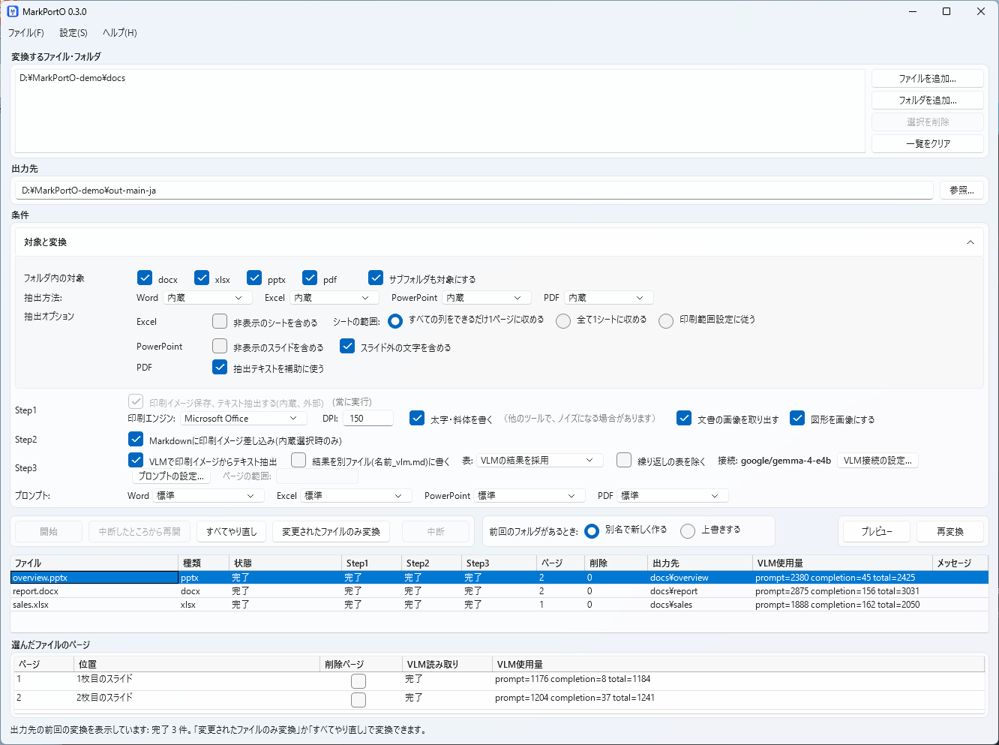

# MarkPortO

[](LICENSE)


[English](README.md) | **日本語**

Word・Excel・PowerPoint・PDFを、**Markdownとページごとの画像に変換するWindowsアプリ**です。



## できること

- 文書の見出し・表・箇条書きなどをMarkdownに変換
- 元のページ画像と変換結果を並べて確認
- フォルダごとの一括変換と、中断した処理の再開
- 画像を読めるモデル（VLM）による読み取り（任意）

開発中です。変換後はプレビューで結果を確認してください。

## 基本の使い方

1. ファイルまたはフォルダを追加します。ドラッグ＆ドロップも使えます。
2. 出力先を選び、「開始」を押します。VLMを使わない場合はStep3をオフにします。
3. 完了したファイルをダブルクリックして、結果を確認します。

出力先には文書ごとのフォルダが作られ、Markdownとページ画像が保存されます。

VLMを使う場合は「設定」でVLM接続を設定します。外部サービスには文書の画像やテキストが送信され、料金がかかる場合があります。

[詳しい使い方](docs/usage.ja.md)：Step1の再変換・Step3の再実行、VLM接続、CLIの全オプション、設定例、出力形式。

## インストール

[Releases](https://github.com/umineko73/MarkPortO/releases) から `MarkPortO-<version>-win-x64.zip` をダウンロードして展開し、`MarkPortO.exe`（画面）または `cli\markporto.exe`（コマンドライン）を実行します。

必要なもの: Windows 11、**.NET 10 デスクトップ ランタイム**、Microsoft Office または [LibreOffice](https://www.libreoffice.org/)（LibreOfficeだけのときは、エンジンで選びます）。Step3には、画像を読めるモデルを載せたOpenAI互換のサーバー（例: LM Studio）、または上のコマンドが要ります。

ソースからビルドするとき: `dotnet build MarkPortO.slnx`（.NET 10 SDK）。

## 開発

```powershell
dotnet test MarkPortO.slnx                             # エンジンが要るテストは、無ければスキップ
./scripts/build.ps1 -Task Publish                      # ビルド、テスト、artifacts/MarkPortO-<version>-win-x64.zip
```

`src/MarkPortO.Core`（変換。UIに依存しない）、`src/MarkPortO.Cli`、`src/MarkPortO.App`（WPF）、`tests`、`scripts`、`tools`。すべてのソースに同じライセンスヘッダーが付きます（`python tools/add-license-header.py`）。CI: `.github/workflows/ci.yml`。

## ライセンス

[GPL-3.0-only](LICENSE)（「それ以降の版」の選択肢はありません）。Copyright (C) 2026 umineko73。依存するものと、同梱の Mermaid のライセンスは、[`THIRD-PARTY-NOTICES.md`](THIRD-PARTY-NOTICES.md) にあります。
