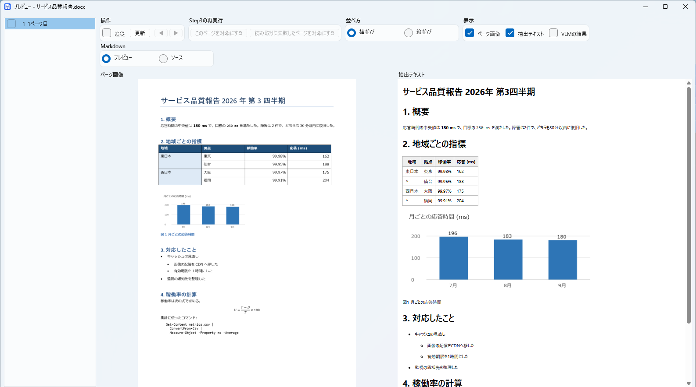

# MarkPortO

[](LICENSE)


[English](README.md) | **日本語**

Word・Excel・PowerPoint・PDF を Markdown に変換する Windows アプリです。
変換結果は元のページ画像（印刷イメージ）と並べて確認でき、RAG用チャンクも作れます。変換結果から元のページを参照できます。


## できること

- **Markdown変換**：見出し・表・箇条書き・コード・数式・図を、Office のファイルから直接読み取ります。
- **プレビュー**：元のページ画像と変換結果を並べて確認できます。
- **図の画像抽出**：図形で描いた図を、画像として切り出します。
- **VLM連携**（任意）：VLM（画像認識対応 LLM）で、図やグラフの中身を書き足します。スキャンしたページは全体を読み取ります。
- **RAG対応**：見出しとページの付いたチャンク（JSON Lines）を書きます。同梱の MCP サーバーで、Claude Code などから検索できます。
- **一括変換**：フォルダごとに変換できます。中断しても、続きから再開できます。
- **作業管理**：変換の履歴、作業セット、更新ファイルだけの再変換、ファイル・ページ単位の再処理に対応しています。
- **外部ツール連携**：MarkItDown や Docling などのコマンドでも変換できます。

開発中です。変換後は、プレビューで結果を確認してください。

## 使い方

1. ファイルまたはフォルダを追加します。ドラッグ＆ドロップもできます。
2. 「プリセット」で「閲覧用」か「RAG用」を選びます。
3. 出力先を選び、「開始」を押します。
4. ファイルをダブルクリックして、結果を確認します。

出力先には、文書ごとに Markdown とページ画像のフォルダができます。

VLM を使うときは、「設定」で接続を登録します。外部サービスには文書の画像やテキストが送信され、料金がかかる場合があります。VLM を使わないときは、Step3 をオフにします。

PDF の内蔵の抽出は簡易的です。PDF には MarkItDown か Docling をおすすめします（[詳しく](docs/usage.ja.md#pdfについて)）。

## プレビュー

ページ画像・抽出テキスト・VLM の結果を並べて、元のページと見比べられます。



## 再変換

結果の一部を直すために、すべてを変換し直す必要はありません。

- **一部のページ**：プレビューで印を付け、「ほかの変換」→「Step3を再実行」で、VLM に読み直させます。
- **一部のファイル**：一覧で選び、右クリックの「選択したファイルをStep1から再変換」を使います。
- **変わったファイルだけ**：「更新ファイルの再変換」を使います。
- **続きから**：中断した変換は「再開」で続けます。Step3 だけを後から足すこともできます。
- **前の作業に戻る**：入力を選ぶと、出力先と条件が前回の状態に戻ります。「ファイル」→「過去の履歴…」からも戻せます。

## RAG で使う

プリセット「RAG用」で変換すると、Markdown の隣に検索用のチャンク（`<名前>_chunks.jsonl`）を書きます。同梱の MCP サーバー（`tools\markporto-rag\`）を登録すると、Claude Code などから検索して、答えの出どころのページまでたどれます。

[チャンクの形式](docs/usage.ja.md#rag用チャンク_chunksjsonl) | [検索サーバーの準備](tools/markporto-rag/README.ja.md)

## インストール

[Releases](https://github.com/umineko73/MarkPortO/releases) から ZIP をダウンロードして展開し、`MarkPortO.exe` を実行します。コマンドラインで使うときは、同じフォルダの `markporto-cli.exe` を使います。

```powershell
markporto-cli convert D:\docs --out D:\out
```

必要なもの：

- Windows 11
- .NET 10 デスクトップ ランタイム
- Microsoft Office または [LibreOffice](https://www.libreoffice.org/)
- VLM を使うとき：VLM を載せた OpenAI 互換のサーバー（LM Studio など）

[詳しい使い方](docs/usage.ja.md)

## 開発

```powershell
dotnet build MarkPortO.slnx
dotnet test MarkPortO.slnx               # エンジンが要るテストは、無ければスキップ
./scripts/build.ps1 -Task Publish        # artifacts/ に ZIP を作る
```

## ライセンス

[GPL-3.0-only](LICENSE)。Copyright (C) 2026 umineko73。依存するもののライセンスは [THIRD-PARTY-NOTICES.md](THIRD-PARTY-NOTICES.md) にあります。
