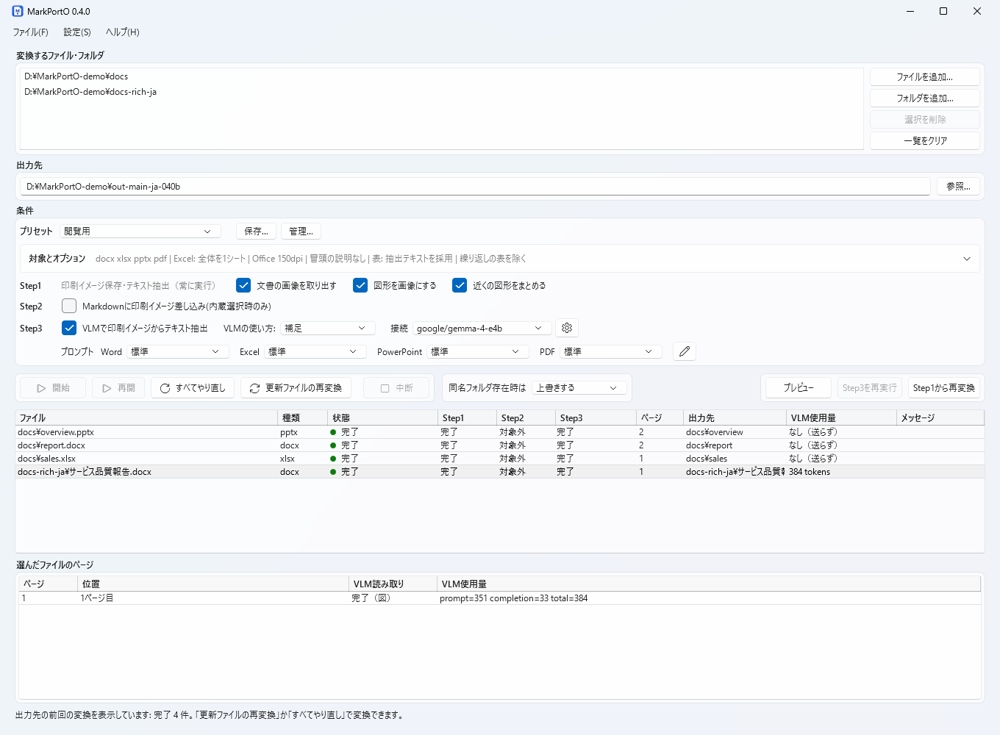

# MarkPortO

[](LICENSE)


[English](README.md) | **日本語**

Word・Excel・PowerPoint・PDFを、**Markdown・ページ画像（PNG）・RAG用のJSON（小分け）に変換するWindowsアプリ**です。どの文も、元のページまでたどれます。



## できること

- 文書の見出し・表・箇条書き・コード・数式などを、Officeのファイルから直接読んでMarkdownに変換
- 元のページ画像と変換結果を並べて確認
- 目的に合わせたプリセット：**閲覧用**（人が読む）と **RAG用**（言語モデルが読む）
- RAG用の小分け（`_chunks.jsonl`）：見出し・ページ・ページ画像つきの検索用の塊。表とコードは途中で切らない。`tools\markporto-rag\` の小さな MCP サーバーで、Claude Code などから検索できる（[tools/markporto-rag/README.ja.md](tools/markporto-rag/README.ja.md)）
- Excel をシートごとに別の Markdown に、フォルダの出力はフォルダごと／中身だけを選べる
- 画像を読めるモデル（VLM）で、図・グラフ・図形の中身を書き足す。スキャンなどはページ全体を読み取る（任意）
- フォルダごとの一括変換と、中断した処理の再開
- 種類ごとに外部コマンド（MarkItDown・Doclingなど）でMarkdownを作成。PDFにはこちらをおすすめします

開発中です。変換後はプレビューで結果を確認してください。

## 使いみち

- **LLM・RAG向けの知識の抽出**：文書の集まりを、言語モデルが読めるMarkdownにします。ページごとに印（`<!-- page: N -->`）とページ画像が付くので、引用した箇所をページまでたどれます。テキストでは取り出しにくいページ（スキャン、図など）は、VLMで画像から読み取れます。
- **Office文書のMarkdownへの移行**：Word・Excel・PowerPoint・PDFの文書を、表・箇条書き・コード・数式・図ごと、Markdownにしてウィキ、ノートツール、Gitリポジトリへ移せます。フォルダごとに変換し、結果はプレビューで元のページと見比べて確認します。

## 基本の使い方

1. ファイルまたはフォルダを追加します。ドラッグ＆ドロップも使えます。
2. 必要なら「プリセット」で「閲覧用」か「RAG用」を選びます。Step1〜3のおすすめの設定が入ります（あとから変えられます）。
3. 出力先を選び、「開始」を押します。VLMを使わない場合はStep3をオフにします。
4. 完了したファイルをダブルクリックして、結果を確認します。

出力先には文書ごとのフォルダが作られ、Markdownとページ画像が保存されます。

VLMを使う場合は「設定」でVLM接続を設定します。外部サービスには文書の画像やテキストが送信され、料金がかかる場合があります。

## VLMで図を読む（Step3）

既定の「補足」では、本文・表・コードはStep1で文書から取り出したものをそのまま使い、VLMはStep1で取り出した画像・グラフ・図形だけを1つずつ読んで、図の直後に中身を書き足します。本文がほとんどないページとPDFはページ全体を読み、Step1で足りるページは送りません（文章だけの文書なら費用はかかりません）。「書き写し」を選ぶと、0.3.6までと同じく、すべてのページをVLMが書き起こします。

## PDFについて

内蔵の抽出は、PDFの文字を簡単に取り出すだけです（見出しは本文とつながり、表は文字の並びになります）。PDFには、外部コマンドの **MarkItDown** か **Docling** をおすすめします。ページ画像・Step3・プレビューはそのまま使え、スキャンしたPDFもStep3がオンならVLMが読み取ります。[詳しい使い方](docs/usage.ja.md#pdfについて)を参照してください。

## RAGで使う（検索用の小分け）

プリセット「RAG用」（または「ステップの詳細」の「RAG 用の小分け（_chunks.jsonl）を書く」、CLI は `--chunks on`）で、Markdown の隣に `<名前>_chunks.jsonl` を書きます。1行に1つの塊（JSON）で、見出しで区切り、表とコードは途中で切りません。塊ごとに、見出しの道筋・ページ・ページ画像・元のファイルと更新日時・前後の塊を持つので、答えの出どころをページまでたどれます。同梱の MCP サーバー `markporto-rag`（`tools\markporto-rag\`）を登録すると、Claude Code などの道具から検索できます。形式は[RAG用の小分け](docs/usage.ja.md#rag用の小分け_chunksjsonl)、検索サーバーの準備は[Claude Code などから検索する](docs/usage.ja.md#claude-code-などから検索する)を参照してください。

## プレビュー

ファイルをダブルクリックすると、プレビューが開きます。ページの画像とMarkdownを並べて表示するので、表・結合セル・箇条書き・コード・数式・図を、元のページと見比べられます。


- ページ画像・抽出テキスト・VLMの結果から、表示するものを選べます。横並びと縦並び、Markdownの描画とソース表示も切り替えられます。
- 左右の矢印キーでページを、◀ ▶ で一覧の前後のファイルを移動します。Ctrl＋ホイールで拡大・縮小します。
- 「追従」をオンにすると、変換中に最後に読み終えたページを表示します。

## 変換し直す

結果の一部を直すために、すべてを変換し直す必要はありません。

- **一部のページをVLMで読み直す（プレビューから）**：プレビューのページ一覧で、読み直したいページにチェックを入れます。「読み取りに失敗したページを対象にする」でも付けられます。メイン画面の「Step3を再実行」を押すと、印を付けたページだけを、画面で選んでいる接続とプロンプトで読み直します。接続やプロンプトを変えたあとは、前の設定で読んだページも読み直せます。
- **一部のファイルを変換し直す**：一覧でファイルを選び、「Step1から再変換」を押します（右クリックのメニューにもあります）。前回のフォルダのMarkdownとページ画像が置き換わります。
- **変更されたファイルだけを変換する**：「更新ファイルの再変換」で、変更されたファイルと新しいファイルだけを変換します。
- **再開**：中断した変換を続けます。失敗したファイルやページの再処理にも使います。

[詳しい使い方](docs/usage.ja.md)：Step1の再変換・Step3の再実行、VLM接続、CLIの全オプション、設定例、出力形式。

## インストール

[Releases](https://github.com/umineko73/MarkPortO/releases) から `MarkPortO-<version>-win-x64.zip` をダウンロードして展開し、`MarkPortO.exe`（画面）または `markporto-cli.exe`（コマンドライン。同じフォルダにあります）を実行します。

0.3.1 までのコマンドラインは、別フォルダの `cli\markporto.exe` でした。`MarkPortO.exe` と見分けにくいため、名前を変えて同じフォルダに置いています。

必要なもの: Windows 11、**.NET 10 デスクトップ ランタイム**、Microsoft Office または [LibreOffice](https://www.libreoffice.org/)（LibreOfficeだけのときは、エンジンで選びます）。Step3には、画像を読めるモデルを載せたOpenAI互換のサーバー（例: LM Studio）、または上のコマンドが要ります。

ソースからビルドするとき: `dotnet build MarkPortO.slnx`（.NET 10 SDK）。

## 開発

```powershell
dotnet test MarkPortO.slnx                             # エンジンが要るテストは、無ければスキップ
./scripts/build.ps1 -Task Publish                      # ビルド、テスト、artifacts/MarkPortO-<version>-win-x64.zip
```

`src/MarkPortO.Core`（変換。UIに依存しない）、`src/MarkPortO.Cli`、`src/MarkPortO.App`（WPF）、`tests`、`scripts`、`tools`。すべてのソースに同じライセンスヘッダーが付きます（`python tools/add-license-header.py`）。CI: `.github/workflows/ci.yml`。

## ライセンス

[GPL-3.0-only](LICENSE)（「それ以降の版」の選択肢はありません）。Copyright (C) 2026 umineko73。依存するものと、同梱の Mermaid のライセンスは、[`THIRD-PARTY-NOTICES.md`](THIRD-PARTY-NOTICES.md) にあります。
