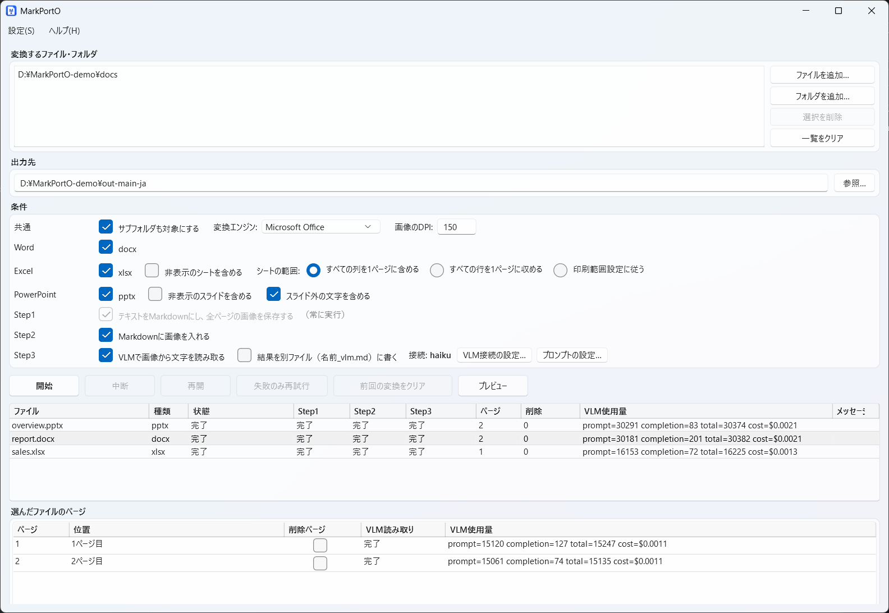
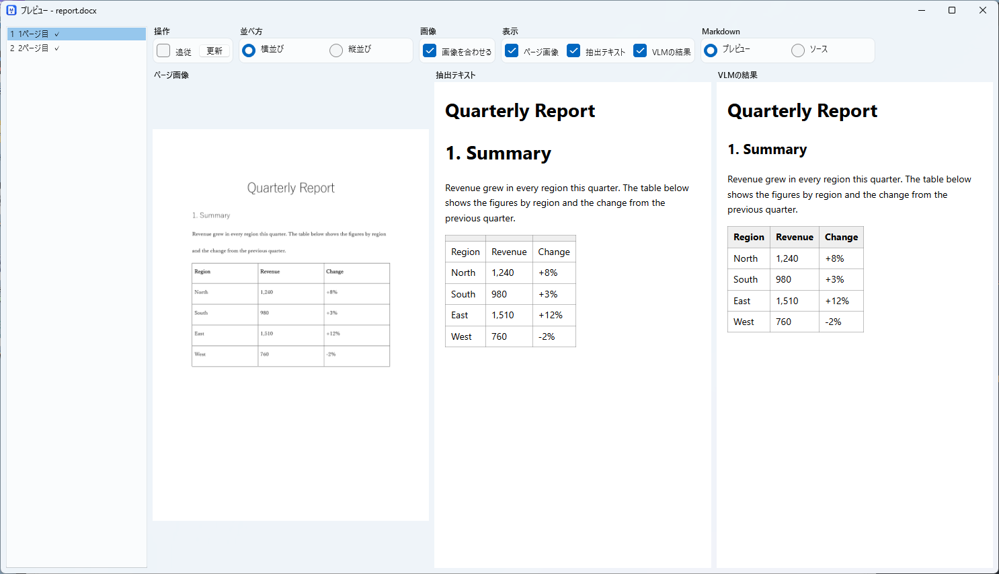
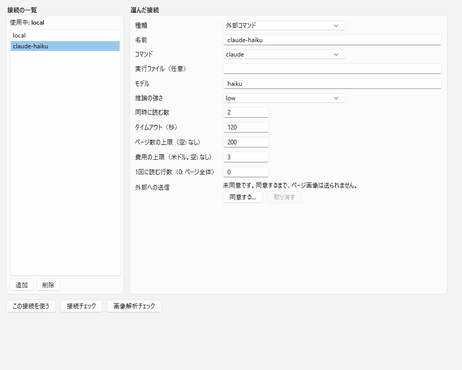

# MarkPortO

[](LICENSE)


[English](README.md) | **日本語**

Word・Excel・PowerPoint・PDF の文書（docx・xlsx・pptx・pdf）を、Markdownと、ページごとの画像（PNG）に変換するWindows向けのツールです。画面（WPF）とコマンドライン（CLI）があり、どちらも同じ変換処理を使うので、ビルドやCIの中で人手なしに動かすこともできます。

> 開発中です。Microsoft Office とサンプルの文書で、実機での確認をしています。LibreOffice と大きな文書は、手動の確認が済んでいません。



## できること

- **Markdownとページ画像**: 文書のテキストをMarkdownにし、全ページをPNGで保存して、Markdownから参照します。構造はファイルの中から読みます（結合セル、脚注、リンク、グラフ、SmartArt、発表者ノート、見出しの番号）。
- **ページをまたぐ表と段落**: 複数のページにまたがる表や段落は、Markdownでは1つの表・段落にし、後のページに注記を入れます。ページのように配置したシートは、ブロックごとの表にします。
- **太字と斜体**: 太字を `**`、斜体を `*` で囲んで書きます（docx、pptx、xlsx）。段落やセルの全体が太字のとき、見出しでは付けません。オフにもできます（「太字・斜体」、`--no-emphasis`）。
- **図表番号（Word）**: エンジンがWordのとき、Wordでフィールドを更新したコピーから読むので、図表の自動番号がWordで見える番号になります。
- **Excel**: シートの全列を1枚の画像にします（列が極端に多くても、DPIを上げて）。全行を1ページにする、シートの印刷範囲に従う、も選べます（「シートの範囲」、`--excel-range`）。
- **PDF**: ページごとに画像にして、VLM（Step3）で読み取ります。PDFに文字の層があれば、補助として使います（ページのテキストにし、画像と一緒に送ります）。文字化けするPDFでは、「抽出テキストを補助に使う」（`--pdf-text off`）を外します。OfficeもLibreOfficeも要りません。
- **PowerPoint**: スライドの外に置いたシェイプ（メモ）の文字を、`> **Off-slide**: …` の引用で書きます。書かないこともできます。
- **削除ページと空白ページ**: ページ全体に「×」の図形が付いたページは削除ページ、何も描かれていないページは空白ページとして示します。どちらもVLMには渡しません。
- **プレビュー**: ページの画像、抽出テキスト、VLMの結果を、変換の実行中から並べて見られます。`mermaid` のブロックは、図として描きます。
- **VLMでの読み取り（Step3、任意）**: OpenAI互換のサーバー、またはログイン済みのコマンド（`claude`、`codex`、`opencode`）の、画像を読めるモデルで、ページの画像から文字を読み取って加えます。トークンと費用を記録します。
- **フォルダ、中断と再開**: ファイルもフォルダも変換できます。中断して、後で続きから再開できます。既存の出力は上書きしません。
- **2つのエンジン**: Microsoft Office（COM）または LibreOffice（画面を出さずに実行）でPDFを作ります。画面は日本語と English です。

## 変換の流れ

| Step | 内容 |
| ---- | ---- |
| Step1 | テキストをMarkdownにし、全ページのPNGを保存します。常に実行します。 |
| Step2 | Markdownに画像を入れます。 |
| Step3 | 任意。各ページの画像をVLMで読み、文字を入れます。 |

## インストール

[Releases](https://github.com/umineko73/MarkPortO/releases) から `MarkPortO-<version>-win-x64.zip` をダウンロードして展開し、`MarkPortO.exe`（画面）または `cli\markporto.exe`（コマンドライン）を実行します。

必要なもの: Windows 11、**.NET 10 デスクトップ ランタイム**、Microsoft Office または [LibreOffice](https://www.libreoffice.org/)（LibreOfficeだけのときは、エンジンで選びます）。Step3には、画像を読めるモデルを載せたOpenAI互換のサーバー（例: LM Studio）、または上のコマンドが要ります。

ソースからビルドするとき: `dotnet build MarkPortO.slnx`（.NET 10 SDK）。

## 使い方

### 画面

ファイルまたはフォルダを追加し（一覧へのドロップでも）、出力先を選んで、「開始」を押します。「条件」には、共通のオプション（サブフォルダ、エンジン、DPI）の行、ファイルの種類ごとの行（その種類を対象にするかと、その種類だけのオプション）、Stepの行があります。ファイルの種類と変換の部分は折りたためます（折りたたむと、選んだ内容を1行で示します。Stepは出たままです）。ファイル一覧とページ一覧は高さを分け合い、間の境目をドラッグして変えられます。1ファイルのときは「ページ範囲」（`3-5,8` のように）で、Step3で読むページを絞れます。設定は `%APPDATA%\MarkPortO\settings.json` に保存され、次回に元に戻ります。

**プレビュー**（ファイルをダブルクリック）: ページ画像・抽出テキスト・VLMの結果のうち見たいものを、横並びか縦並びで、描画かソースで見られます。「追従」は、最後に読み終えたページを表示します。ページを移したときや新しい結果が来たときも、拡大率とスクロール位置は保たれます。左右の矢印キーとマウスホイールでページを移り（ホイールは、まずページの端で止まります）、右ボタンのドラッグでスクロールできます。



**VLM接続** と **プロンプト** は、「設定」メニューにあります。プロンプトに `{pagetext}` を書くと、Step1がそのページから取ったテキストを、画像と一緒に送ります。



変換の実行中は、条件を変えられません。再開できる前回の変換があるときは、「前回の変換をクリア」で、変えられるようになります。「失敗のみ再試行」は、VLMが読めなかったページだけを読み直します。

### コマンドライン

```powershell
markporto convert D:\docs\report.docx --out D:\out
markporto convert D:\docs --out D:\out --types docx,xlsx --recurse
markporto convert D:\docs --out D:\out --step3 on --settings settings.json   # VLMで読む
markporto convert --resume --out D:\out                                      # 中断した変換を続ける
markporto list-jobs --out D:\out
markporto check-connection --settings settings.json
```

主なオプション: `--settings`、`--out`、`--types`、`--recurse`、`--include-hidden`（または `--include-hidden-sheets`、`--include-hidden-slides`）、`--emphasis` / `--no-emphasis`（太字を `**`、斜体を `*` で囲む）、`--no-include-off-slide`、`--pdf-text on|off`、`--engine`、`--dpi`、`--pages <範囲>`（1ファイルのとき、Step3で読むページ。`3-5,8` のように）、`--excel-range columns|rows|print-area`、`--step2 on|off`、`--step3 on|off`、`--vlm-separate on|off`、`--result <file>`、`--resume`、`--retry-failed`、`--quiet`、`--max-pages`、`--max-cost`、`--parallel`。指定は `settings.json` より優先されます。

終了コード: `0` 成功、`1` 一部のファイルが失敗、`2` 引数や設定が不正、`3` 開始前の確認に失敗（同意がない場合を含む）、`4` 利用上限・ログイン切れ・ページ数や費用の上限で停止（`--resume` で続ける）、`130` 中断。

### `settings.json`

```json
{
  "schemaVersion": 1,
  "input": { "paths": ["D:\\docs"], "recurse": true, "types": ["docx", "xlsx", "pptx", "pdf"], "includeHiddenSheets": false, "includeHiddenSlides": false, "includeOffSlideText": true },
  "output": { "folder": "D:\\out" },
  "ui": { "language": "system", "theme": "system" },
  "engine": { "kind": "office" },
  "images": { "dpi": 150 },
  "steps": { "step2": true, "step3": true },
  "vlm": {
    "selected": "local",
    "connections": [
      { "name": "local", "baseUrl": "http://localhost:1234/v1", "model": "vision-model", "apiKeyEnv": "MARKPORTO_API_KEY", "timeoutSeconds": 120 }
    ]
  }
}
```

場所は、環境変数 `MARKPORTO_SETTINGS` で変えられます。アクセスキーは、値ではなく環境変数の*名前*（`apiKeyEnv`）を書きます。画面で入力したキーは、現在のWindowsユーザーだけが読める形（DPAPI）で保存し、ログや出力には出ません。

### `claude`・`codex`・`opencode` で読み取る

```json
{ "name": "cloud", "kind": "command", "command": "claude", "model": "haiku", "effort": "low", "parallel": 2, "maxPages": 200, "maxCostUsd": 3.0 }
```

ページ画像ごとに、空の一時フォルダで、コマンドを1回実行します。**自分の設定・フック・メモリ・ツールは使いません。** ページ数や費用の上限、利用上限、ログイン切れ、同じ失敗が3ページ続いたときは、停止します（再開できます）。

**ページの画像と、ページのテキストは、コマンドの先のサービスへ、ネットワークの外に送られ、費用がかかることがあります。** 機密の文書には使わないでください。このような接続（と、ローカルネットワークの外にあるOpenAI互換の接続）は、同意したあとだけ使います。接続の設定の「同意...」を押すか、`markporto consent <名前> --settings settings.json` を実行します（`--revoke` で取り消し）。

## 出力

```text
out/report/
├── report.md          # 元のファイル名と、構造の説明から始まります
├── report_vlm.md      # --vlm-separate on のときだけ: Step3の結果
└── images/
    ├── page-001.png
    └── page-002.png
```

結合セルは notePM 方式で書きます（`<` は左のセル、`^` は上のセルと結合）。取り消し線の付いた文字は、`~~文字~~` で囲んで書きます。`<!-- page: N -->` の行が、各ページの始まりです。

## 開発

```powershell
dotnet test MarkPortO.slnx                             # エンジンが要るテストは、無ければスキップ
./scripts/build.ps1 -Task Publish                      # ビルド、テスト、artifacts/MarkPortO-<version>-win-x64.zip
```

`src/MarkPortO.Core`（変換。UIに依存しない）、`src/MarkPortO.Cli`、`src/MarkPortO.App`（WPF）、`tests`、`scripts`、`tools`。すべてのソースに同じライセンスヘッダーが付きます（`python tools/add-license-header.py`）。CI: `.github/workflows/ci.yml`。

## ライセンス

[GPL-3.0-only](LICENSE)（「それ以降の版」の選択肢はありません）。Copyright (C) 2026 umineko73。依存するものと、同梱の Mermaid のライセンスは、[`THIRD-PARTY-NOTICES.md`](THIRD-PARTY-NOTICES.md) にあります。
