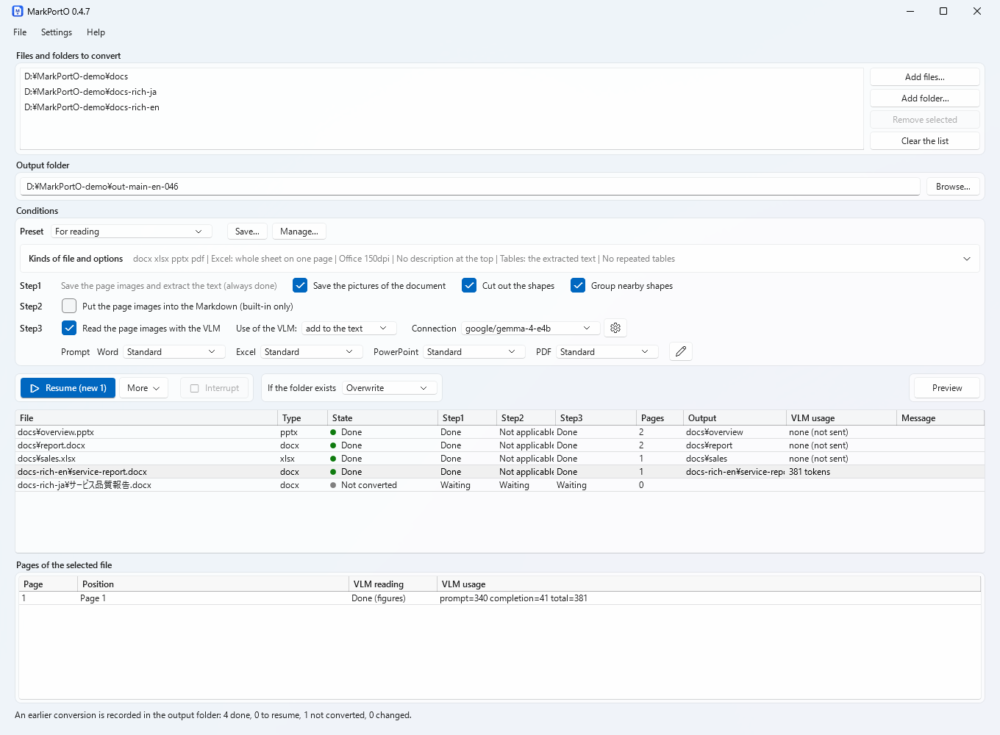
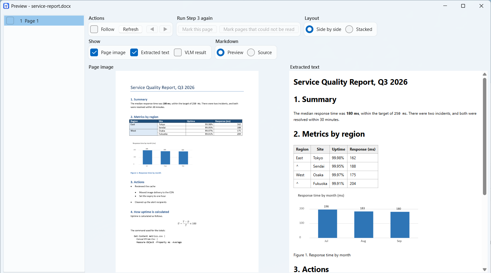

# MarkPortO

[](LICENSE)


**English** | [日本語](README.ja.md)

MarkPortO is a **Windows app that converts Word, Excel, PowerPoint and PDF files into Markdown, page images (PNG) and chunks for RAG (JSON Lines)** — every passage can be traced back to its page.



## Features

- Convert headings, tables, lists, code and equations into Markdown, read directly from the Office file.
- Compare the result with the original page images in a preview.
- Choose a preset for the purpose: **For reading** (people read the Markdown) or **For RAG** (a language model reads it).
- Chunks for RAG (`_chunks.jsonl`): the document in chunks for search, each with its headings, pages and page images; tables and code are not cut in the middle. A small MCP server in `tools\markporto-rag\` lets tools such as Claude Code search them ([tools/markporto-rag/README.md](tools/markporto-rag/README.md)).
- Write an Excel book as one Markdown for each sheet; put the output of a folder with or without a folder of its name.
- Cut the diagrams drawn with shapes in Word, PowerPoint and Excel out of the page image as pictures; shapes near one another, or on the same row, are one picture.
- Leave out the text of a page crossed out with a "×" drawn with shapes (a deleted page).
- Optionally let an image-capable model (VLM) add what the figures, charts and shapes show, or read whole pages (scans).
- Convert folders of documents and resume interrupted runs.
- Use an external command (MarkItDown, Docling and so on) to write the Markdown of a kind of file; recommended for PDF files.

Under development. Results vary with document layout, so check the preview after conversion.

## Use cases

- **Knowledge extraction for LLMs and RAG**: Turn a library of documents into Markdown that a language model can read. Each page is marked (`<!-- page: N -->`) and has its own page image, so a passage can be traced back to its page, and a page that is hard to extract as text (a scan, a diagram) can be read from its image with a VLM.
- **Office-to-Markdown migration**: Move Word, Excel, PowerPoint and PDF documents into a wiki, a notes tool or a Git repository as Markdown, with their tables, lists, code, equations and pictures. Convert whole folders, and check each result against the original page in the preview.

## Getting started

You need **Windows 11** and the **.NET 10 Desktop Runtime**. Office documents also require Microsoft Office or [LibreOffice](https://www.libreoffice.org/).

1. Download `MarkPortO-<version>-win-x64.zip` from [Releases](https://github.com/umineko73/MarkPortO/releases).
2. Extract the ZIP and run `MarkPortO.exe`.
3. If you use LibreOffice, select it as the engine in the app.

## Basic usage

1. Add files or a folder, or drag them onto the app.
2. Choose an output folder.
3. Choose a **Preset** if you like (**For reading** or **For RAG**). It puts the recommended settings of Step1 to Step3; you can still change them.
4. Press **Start**. Turn off Step3 if you do not want to use the VLM.
5. Double-click a completed file to preview the result.

Each document gets a folder containing its Markdown (`.md`) and page images (`images/`). Open them from the file list's right-click menu.

To use the VLM, set up a VLM connection in **Settings** and turn on Step3. External services receive document images and text, and may charge for usage.

## Reading figures with a VLM (Step3)

By default (**Add to the text**), the text, tables and code stay as Step1 read them from the document, and the VLM reads only the pictures, charts and shapes that Step1 saved, one by one. What they show is written after each figure. Pages with almost no text, and PDF files, are read whole; pages that Step1 covers are not sent at all, so a document of text costs nothing. **Read every page** has the VLM write out every page, as up to 0.3.6.

## PDF files

The built-in extraction takes the text of a PDF simply (headings run into the text, a table is a line of words). For PDF files, choose **MarkItDown** or **Docling** as an external command; the page images, Step3 and the preview still work, and a scanned PDF is read by the VLM when Step3 is on. See [Detailed usage](docs/usage.md#pdf-files).

## Using it for RAG (chunks for search)

With the preset For RAG (or "Write the chunks for RAG (_chunks.jsonl)" in the details of the steps, `--chunks on` on the command line), a file `<name>_chunks.jsonl` is written next to the Markdown: one chunk (a JSON object) on each line, cut at the headings, with tables and code never cut in the middle. Each chunk has the headings it is under, its pages and page images, the original file and its date, and the chunks before and after it, so an answer can be traced to its page. With the MCP server `markporto-rag` in `tools\markporto-rag\`, Claude Code and similar tools can search them. See [Chunks for RAG](docs/usage.md#chunks-for-rag-_chunksjsonl) for the format and [Searching from Claude Code and similar tools](docs/usage.md#searching-from-claude-code-and-similar-tools) for setting up the server.

## Preview

Double-click a file to open the preview. The image of each page is shown next to its Markdown, so you can check tables, merged cells, lists, code, equations and pictures against the original.



- Show the page image, the extracted text and the VLM result, side by side or stacked. The Markdown can be shown rendered or as source.
- Move between pages with the arrow keys, and to the previous or next file with ◀ ▶. Ctrl+wheel zooms.
- **Follow** shows the last page that was read while a conversion is running.

## Converting again

You do not have to convert everything again to fix part of a result.

- **Read some pages again with the VLM (from the preview)**: check the pages in the preview's page list, or press **Mark pages that could not be read**. Then choose **Run Step 3 again** from the ▼ menu of the run button. Only the marked pages are read again, with the connection and prompt chosen on the screen. After you change the connection or a prompt, **Run Step 3 again** also reads the pages that were read with the earlier settings.
- **Convert some files again**: select them in the list and choose **Convert the selected files again from Step 1** from the right-click menu (or the ▼ menu of the run button). Their Markdown and page images in the earlier folder are replaced.
- **Convert the files that changed**: **Reconvert updated files** converts only the changed and new files.
- **Resume**: goes on file by file: an interrupted file goes on, failed files and pages run again, and a step that was off is added (Step3 to files converted up to Step2, for example).
- **Back to the earlier state**: choosing the files and folders to convert puts back their output folder, the file list and the conditions of last time. The inputs, the output folder and the conditions can be saved under a name as a **work set**. Each document folder keeps a record of its source, conditions and state (`conversion.json`).

## Command line

You can also use `markporto-cli.exe` from the ZIP (in the same folder as `MarkPortO.exe`):

```powershell
markporto-cli convert D:\docs\report.docx --out D:\out
markporto-cli convert D:\docs --out D:\out --types docx,xlsx --recurse
```

Up to 0.3.1 the command line was `cli/markporto.exe` in a folder of its own; it now has a name of its own, so that it does not look like `MarkPortO.exe`.

See [Detailed usage](docs/usage.md) for reconversion, VLM connections, all CLI options and configuration examples.

## Development

```powershell
dotnet test MarkPortO.slnx                             # tests that need an engine are skipped if it is not installed
./scripts/build.ps1 -Task Publish                      # build, test, and write artifacts/MarkPortO-<version>-win-x64.zip
```

`src/MarkPortO.Core` (conversion, no UI), `src/MarkPortO.Cli`, `src/MarkPortO.App` (WPF), `tests`, `scripts`, `tools`. Every source file has the same license header (`python tools/add-license-header.py`). CI: `.github/workflows/ci.yml`.

## License

[GPL-3.0-only](LICENSE) (the "or any later version" option is not offered). Copyright (C) 2026 umineko73. The licenses of the dependencies, including Mermaid, are in [`THIRD-PARTY-NOTICES.md`](THIRD-PARTY-NOTICES.md).
