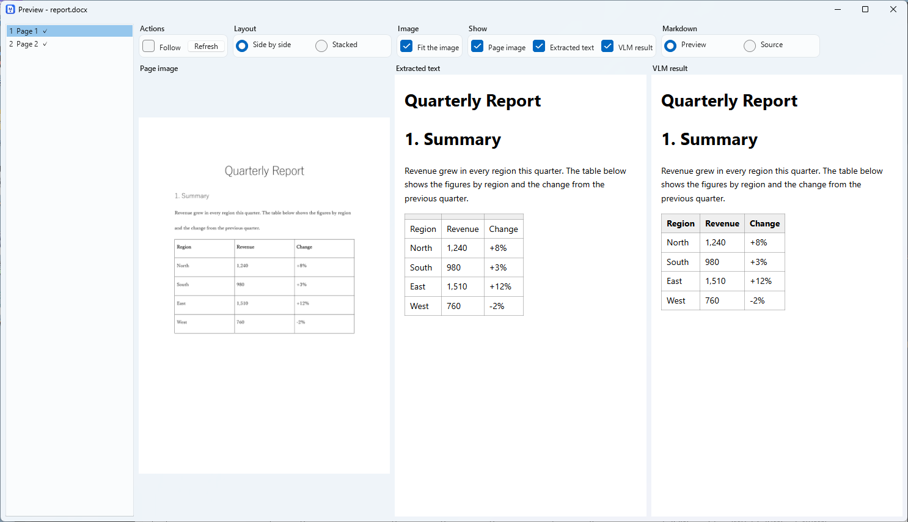

# MarkPortO

[](LICENSE)


**English** | [日本語](README.ja.md)

MarkPortO converts Word, Excel, PowerPoint and PDF documents (docx, xlsx, pptx, pdf) into Markdown plus one PNG image per page. It is a WPF desktop app and a command-line tool that share the same conversion code, so it can also run unattended in a build or CI job.

> **Status: under development.** Checked on a real machine with Microsoft Office and a few sample documents; LibreOffice and large documents are not checked by hand.


## Features

- **Markdown and page images.** The text becomes Markdown and every page is saved as a PNG, referred to from the Markdown. The structure is read from the file itself (merged cells, footnotes, links, charts, SmartArt, speaker notes, the numbers of headings).
- **Tables and paragraphs that follow the pages.** A table or a paragraph that runs over several pages is one table or paragraph in the Markdown, with a note on the later pages. A sheet laid out like a page is cut into one table per block.
- **Excel.** All columns of a sheet go on one image (even a very wide one, at a higher DPI), or all rows, or the print setup of the sheet (**Sheet range**, `--excel-range`).
- **PDF.** Each page becomes an image, and the VLM (Step3) reads it. The text layer of the PDF, if it has one, only helps: it is the text of the page, and it is sent with the image. Turn it off (**Use the extracted text as a help**, `--pdf-text off`) for a PDF whose text is garbled. No Office or LibreOffice is needed.
- **PowerPoint.** Text of shapes outside the slide (memos on the pasteboard) is written as `> **Off-slide**: …`; it can be left out.
- **Deleted and blank pages.** A page crossed out with a full-page "X" is a deleted page; a blank page is marked. Neither is sent to the VLM.
- **Preview.** See the page image, the extracted text and the VLM result side by side while the conversion runs. `mermaid` blocks are drawn as diagrams.
- **Optional VLM reading (Step3).** A VLM (a model that can read images), through an OpenAI-compatible server or a command you are logged in to (`claude`, `codex`, `opencode`), reads each page image and adds the text. Token usage and cost are recorded.
- **Folders, interrupt and resume.** Convert a file or a folder; interrupt and continue later. Existing output is never overwritten.
- **Two engines.** Microsoft Office (COM) or LibreOffice (headless) makes the PDF. English and Japanese UI.

## How it works

| Step | What it does |
| ---- | ------------ |
| Step1 | Extracts the text into Markdown and saves the PNG of every page. Always runs. |
| Step2 | Inserts the images into the Markdown. |
| Step3 | Optional. Reads each page image with a VLM and inserts the text. |

## Install

Download `MarkPortO-<version>-win-x64.zip` from [Releases](https://github.com/umineko73/MarkPortO/releases), unzip it, and run `MarkPortO.exe` (the app) or `cli\markporto.exe` (the command line).

Requirements: Windows 11, the **.NET 10 Desktop Runtime**, and either Microsoft Office or [LibreOffice](https://www.libreoffice.org/) (if only LibreOffice is installed, choose it as the engine). Step3 needs an OpenAI-compatible server with a model that can read images (for example LM Studio), or one of the commands above.

To build from source: `dotnet build MarkPortO.slnx` (.NET 10 SDK).

## Usage

### Desktop app

Add files or a folder (or drop them on the list), choose an output folder, and press **Start**. The **Conditions** have a row of common options (sub-folders, engine, DPI), a row for each kind of file (convert it or not, and the options only for it), and the steps. The list of files and the list of pages share the height; drag the bar between them to change it. The values are saved to `%APPDATA%\MarkPortO\settings.json` and restored at the next start.

**Preview** (double-click a file): choose which of the page image, the extracted text and the VLM result to show, side by side or stacked, drawn or as source. **Follow** shows the page read last. Arrow keys and the mouse wheel change the page; dragging with the right button scrolls.



**VLM connections** and **prompts** are in the **Settings** menu. A prompt can contain `{pagetext}`, the text Step1 took from the page (it is sent with the image).


While a conversion runs the conditions cannot be changed. If the previous conversion can be resumed, **Clear the previous conversion** unlocks them. **Retry failed** reads only the pages the VLM could not read.

### Command line

```powershell
markporto convert D:\docs\report.docx --out D:\out
markporto convert D:\docs --out D:\out --types docx,xlsx --recurse
markporto convert D:\docs --out D:\out --step3 on --settings settings.json   # read with a VLM
markporto convert --resume --out D:\out                                      # continue an interrupted run
markporto list-jobs --out D:\out
markporto check-connection --settings settings.json
```

Main options: `--settings`, `--out`, `--types`, `--recurse`, `--include-hidden` (or `--include-hidden-sheets`, `--include-hidden-slides`), `--emphasis` / `--no-emphasis` (bold and italic text between `**` and `*`), `--no-include-off-slide`, `--pdf-text on|off`, `--engine`, `--dpi`, `--pages <range>` (one file: the pages that Step3 reads, like `3-5,8`), `--excel-range columns|rows|print-area`, `--step2 on|off`, `--step3 on|off`, `--vlm-separate on|off`, `--result <file>`, `--resume`, `--retry-failed`, `--quiet`, `--max-pages`, `--max-cost`, `--parallel`. Options override `settings.json`.

Exit codes: `0` success, `1` some files failed, `2` invalid arguments or settings, `3` the checks before the run failed (including a missing consent), `4` stopped by a usage limit, a login or a limit of pages or cost (use `--resume`), `130` interrupted.

### `settings.json`

```json
{
  "schemaVersion": 1,
  "input": { "paths": ["D:\\docs"], "recurse": true, "types": ["docx", "xlsx", "pptx", "pdf"], "includeHiddenSheets": false, "includeHiddenSlides": false, "includeOffSlideText": true },
  "output": { "folder": "D:\\out" },
  "ui": { "language": "system", "theme": "system" },
  "engine": { "kind": "office" },
  "images": { "dpi": 150 },
  "steps": { "step2": true, "step3": true },
  "vlm": {
    "selected": "local",
    "connections": [
      { "name": "local", "baseUrl": "http://localhost:1234/v1", "model": "vision-model", "apiKeyEnv": "MARKPORTO_API_KEY", "timeoutSeconds": 120 }
    ]
  }
}
```

The location can be changed with the environment variable `MARKPORTO_SETTINGS`. Write the *name* of an environment variable (`apiKeyEnv`) rather than a key; a key typed in the app is stored so that only the current Windows user can decrypt it (DPAPI), and never appears in logs or output.

### Reading with `claude`, `codex` or `opencode`

```json
{ "name": "cloud", "kind": "command", "command": "claude", "model": "haiku", "effort": "low", "parallel": 2, "maxPages": 200, "maxCostUsd": 3.0 }
```

For each page image the command is run once, in an empty temporary folder, **without your own settings, hooks, memory or tools**. The conversion stops (and can be resumed) at a limit of pages or cost, a usage limit, a missing login, or three failures in a row.

**The page images, and the text of the pages, are sent to the service behind the command, outside your network, and charges may apply.** Do not use this for confidential documents. Such a connection (and an OpenAI-compatible one outside the local network) is used only after you agree: press **Agree...** in the connection settings, or run `markporto consent <name> --settings settings.json` (`--revoke` withdraws it).

## Output

```text
out/report/
├── report.md          # starts with the source file name and a description of the structure
├── report_vlm.md      # only with --vlm-separate on: the results of Step3
└── images/
    ├── page-001.png
    └── page-002.png
```

Merged table cells are written in the notePM style (`<` joins the cell on the left, `^` the cell above). Text with a strikethrough is written as `~~text~~`. A `<!-- page: N -->` line starts each page.

## Development

```powershell
dotnet test MarkPortO.slnx                             # tests that need an engine are skipped if it is not installed
./scripts/build.ps1 -Task Publish                      # build, test, and write artifacts/MarkPortO-<version>-win-x64.zip
```

`src/MarkPortO.Core` (conversion, no UI), `src/MarkPortO.Cli`, `src/MarkPortO.App` (WPF), `tests`, `scripts`, `tools`. Every source file has the same license header (`python tools/add-license-header.py`). CI: `.github/workflows/ci.yml`.

## License

[GPL-3.0-only](LICENSE) (the "or any later version" option is not offered). Copyright (C) 2026 umineko73. The licenses of the dependencies, including Mermaid, are in [`THIRD-PARTY-NOTICES.md`](THIRD-PARTY-NOTICES.md).
