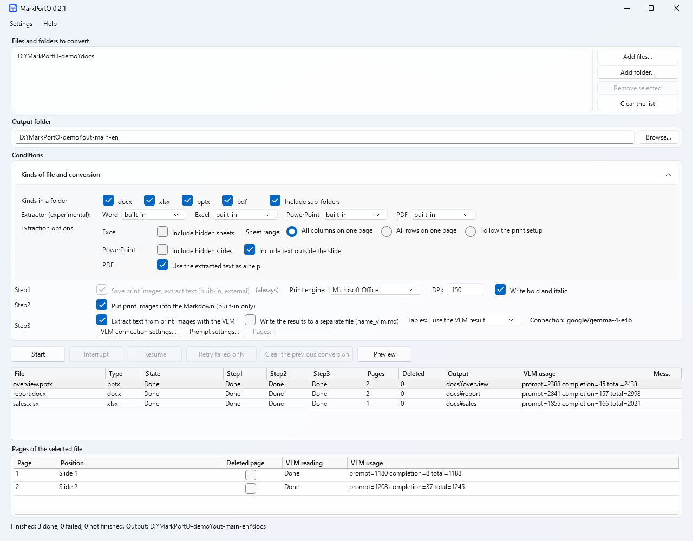

# MarkPortO

[](LICENSE)


**English** | [日本語](README.ja.md)

MarkPortO is a **Windows app that converts Word, Excel, PowerPoint and PDF files into Markdown and page images (PNG)**.



## Features

- Convert headings, tables and lists into Markdown.
- Compare the result with the original page images in a preview.
- Convert folders of documents and resume interrupted runs.
- Optionally read pages with an image-capable AI model (VLM).

Under development. Results vary with document layout, so check the preview after conversion.

## Getting started

You need **Windows 11** and the **.NET 10 Desktop Runtime**. Office documents also require Microsoft Office or [LibreOffice](https://www.libreoffice.org/).

1. Download `MarkPortO-<version>-win-x64.zip` from [Releases](https://github.com/umineko73/MarkPortO/releases).
2. Extract the ZIP and run `MarkPortO.exe`.
3. If you use LibreOffice, select it as the engine in the app.

## Basic usage

1. Add files or a folder, or drag them onto the app.
2. Choose an output folder.
3. Press **Start**. Turn off Step3 if you do not want to use AI.
4. Double-click a completed file to preview the result.

Each document gets a folder containing its Markdown (`.md`) and page images (`images/`). Open them from the file list's right-click menu.

To use AI, set up a VLM connection in **Settings** and turn on Step3. External services receive document images and text, and may charge for usage.

## Command line

You can also use `cli/markporto.exe` from the ZIP:

```powershell
markporto convert D:\docs\report.docx --out D:\out
markporto convert D:\docs --out D:\out --types docx,xlsx --recurse
```

See [Detailed usage](docs/usage.md) for reconversion, AI connections, all CLI options and configuration examples.

## Development

```powershell
dotnet test MarkPortO.slnx                             # tests that need an engine are skipped if it is not installed
./scripts/build.ps1 -Task Publish                      # build, test, and write artifacts/MarkPortO-<version>-win-x64.zip
```

`src/MarkPortO.Core` (conversion, no UI), `src/MarkPortO.Cli`, `src/MarkPortO.App` (WPF), `tests`, `scripts`, `tools`. Every source file has the same license header (`python tools/add-license-header.py`). CI: `.github/workflows/ci.yml`.

## License

[GPL-3.0-only](LICENSE) (the "or any later version" option is not offered). Copyright (C) 2026 umineko73. The licenses of the dependencies, including Mermaid, are in [`THIRD-PARTY-NOTICES.md`](THIRD-PARTY-NOTICES.md).
