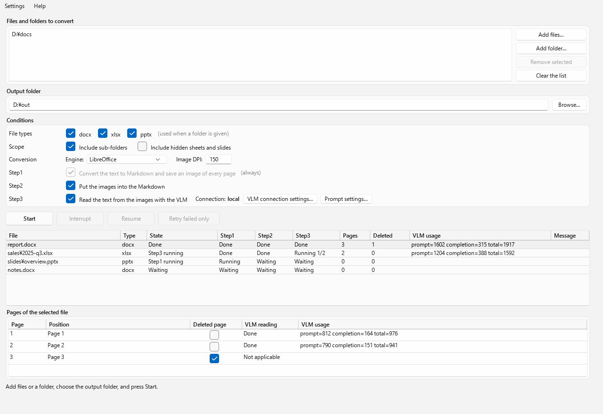
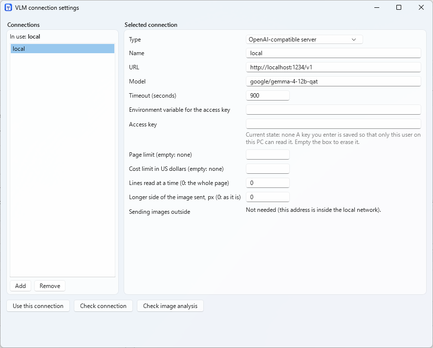
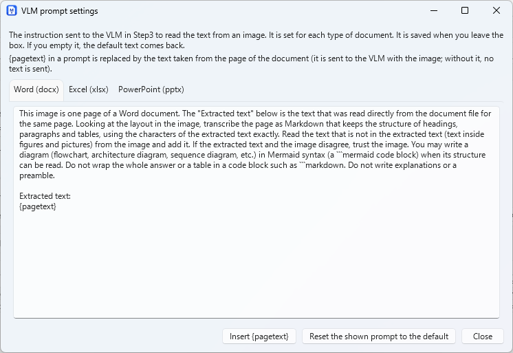

# MarkPortO

[](LICENSE)


**English** | [日本語](README.ja.md)

MarkPortO converts Word, Excel and PowerPoint documents (docx, xlsx, pptx) into Markdown plus one PNG image per page. It comes as a WPF desktop app and a command-line tool, and both use the same conversion code, so it can also run unattended in a build or CI job.

> **Status: under development.** Some parts still need a manual check on a real machine.



*The main window, drawn with sample data.*

## Features

- **Markdown and page images.** The text of a document becomes Markdown, and every page is saved as a PNG. Each page's place in the Markdown refers to its image.
- **Excel sheets in one image.** All columns of a sheet fit in a single image. A sheet with an extreme number of columns is split at column boundaries into several images.
- **Deleted pages.** A page that is crossed out with a full-page "X" shape is treated as deleted: its image is kept, and the Markdown only marks the place with a notice.
- **Folders and filters.** Convert a single file or a whole folder, optionally including sub-folders, and choose which of docx / xlsx / pptx to convert. If the output folder already exists, a number is added (`name (2)`); existing output is never overwritten.
- **Interrupt and resume.** A run can be interrupted and continued later. Files that are already done are not converted again.
- **Optional VLM reading (Step3).** A VLM (a model that can read images) behind an OpenAI-compatible server reads the text from each page image and adds it to the Markdown. You can register several connections and switch between them. Token usage is recorded per page and per file.
- **Two engines.** Microsoft Office (COM) or LibreOffice (headless) turns documents into PDF. The app lists only the engines that are installed.
- **English and Japanese UI.** The first start follows the language of Windows (English if that language is not supported), and it can be switched from the menu without a restart. The language of the Markdown text follows the UI language at the start of a run. Command-line messages are always English.

## How it works

A conversion has three steps, and each step runs on its own thread so that the steps overlap across files:

| Step | What it does |
| ---- | ------------ |
| Step1 | Extracts the text into a Markdown file and saves the PNG of every page. Always runs. |
| Step2 | Inserts the images into the Markdown. |
| Step3 | Optional. Reads each page image with a VLM and inserts the text into the Markdown. |

## Requirements

- Windows 11
- .NET 10 SDK (to build)
- Either Microsoft Office (Word, Excel and PowerPoint) or [LibreOffice](https://www.libreoffice.org/). It is used to turn documents into PDF, and no window is shown. If only LibreOffice is installed, set `engine.kind` to `libreoffice`.
- For Step3: an OpenAI-compatible server with a model that can read images (for example LM Studio).

## Quick start

```powershell
git clone https://github.com/umineko73/MarkPortO.git
cd MarkPortO
dotnet build MarkPortO.slnx

# Command line
dotnet run --project src/MarkPortO.Cli -- convert D:\docs\report.docx --out D:\out

# Desktop app
dotnet run --project src/MarkPortO.App
```

In the app, add files or a folder (or drop them on the list), choose an output folder (or drop a folder on its box), and press **Start**.

## Usage

### Command line

```powershell
dotnet run --project src/MarkPortO.Cli -- convert D:\docs\report.docx --out D:\out
dotnet run --project src/MarkPortO.Cli -- convert D:\docs --out D:\out --types docx,xlsx --recurse
dotnet run --project src/MarkPortO.Cli -- convert --resume --out D:\out      # continue an interrupted run
dotnet run --project src/MarkPortO.Cli -- list-jobs --out D:\out             # list the runs in an output folder
dotnet run --project src/MarkPortO.Cli -- convert D:\docs --out D:\out --step3 on --settings settings.json   # read with a VLM
dotnet run --project src/MarkPortO.Cli -- check-connection --settings settings.json    # test the VLM server
dotnet run --project src/MarkPortO.Cli -- list-connections --settings settings.json   # list the connections (keys are not shown)
```

Main options: `--settings <path>`, `--out`, `--types`, `--recurse`, `--include-hidden`, `--engine`, `--dpi`, `--excel-range columns|rows|print-area`, `--step2 on|off`, `--step3 on|off`, `--vlm-separate on|off`, `--result <file>` (save the result as JSON), `--resume`, `--job`, `--retry-failed`, `--quiet`, `--max-pages`, `--max-cost`, `--parallel`. Options on the command line override `settings.json`.

Exit codes: `0` everything succeeded, `1` some files failed, `2` invalid arguments or settings, `3` the checks before the run failed (including a missing consent), `4` stopped by a usage limit, a login or a limit of pages or cost (continue with `--resume`), `130` interrupted (`Ctrl+C`; continue with `--resume`).

### Desktop app

The **Settings** menu has the language (follow Windows / Japanese / English), the VLM connections and the prompts. The **Help** menu has the version and the license notices.

**VLM connections** (Settings → VLM connection settings): add an OpenAI-compatible server or an external command (`claude`, `codex`, `opencode`), set the model, the limits and the consent, and check the connection and the image analysis.



**Prompts** (Settings → Prompt settings): the instruction sent to the VLM is set for each type of document (docx, xlsx, pptx).



**Preview**: double-click a file in the list (or use the right-click menu or the **Preview** button) to see its pages: the list of pages, the image of the page, and its Markdown (drawn, or as written; the VLM result can be shown on its own). While a file is converted the preview follows the work: **Follow** selects the page being read.

While a conversion runs, the conditions and the inputs cannot be changed. When the previous conversion in the output folder can be resumed, the items that a resume does not use (types, range, engine, DPI) are locked too; **Clear the previous conversion** gives it up and unlocks them.

The list shows the state of each file: waiting, Step1 to Step3 running, done, done (some pages failed), failed, interrupted. For a folder, a file is shown by its path relative to that folder. If the VLM could not read some pages of a file, **Retry failed** reads only those pages again. Values you set in the app are saved to `settings.json` (`%APPDATA%\MarkPortO\settings.json`) at once and restored on the next start.

### `settings.json`

```json
{
  "schemaVersion": 1,
  "input": { "paths": ["D:\\docs"], "recurse": true, "types": ["docx", "xlsx", "pptx"], "includeHidden": false },
  "output": { "folder": "D:\\out" },
  "ui": { "language": "system", "theme": "system" },
  "engine": { "kind": "office" },
  "images": { "dpi": 150 },
  "steps": { "step2": true, "step3": true },
  "vlm": {
    "selected": "local",
    "connections": [
      { "name": "local", "baseUrl": "http://localhost:1234/v1", "model": "vision-model", "apiKeyEnv": "MARKPORTO_API_KEY", "timeoutSeconds": 120 }
    ]
  }
}
```

The location of the file can be changed with the environment variable `MARKPORTO_SETTINGS`; both the app and the command line use it when `--settings` is not given. `ui.language` is `system`, `ja` or `en`. `ui.theme` is `system`, `light` or `dark`.

**About API keys.** Write the *name* of an environment variable (`apiKeyEnv`) in `settings.json`; the value itself is not stored. A key typed in the app is stored so that only the current Windows user can decrypt it (DPAPI). Keys never appear in logs, Markdown or state files.

### Reading with Claude Code, Codex or OpenCode (external commands)

**Notes on the Markdown.**
- A Markdown table cannot merge cells, so merged cells are marked in the notePM style: `<` is merged with the cell on its left, `^` with the cell above. The header row cannot be merged, so its value is repeated. An empty cell stays empty. A table with no header row gets an empty header row, so that its first row stays data.
- The structure of a document is read from the XML inside the file (Office is used only to make the page images). Excel numbers are written as the cells show them (`25.6%`, `¥1,234,567`); hidden rows and columns are left out; the tables of a sheet are written one by one; links, comments and charts (the values saved in the file) are written. Word footnotes, links, the alternative text of pictures and tables inside tables are written; so are PowerPoint speaker notes, links, alternative text, charts and SmartArt text.
- If the VLM wraps its answer in a code block such as ```` ```markdown ````, the block is taken off (a `mermaid` block stays).
- Check **Write the results to a separate file** (`--vlm-separate on`) to keep the VLM results out of the Markdown of the document: they go to `name_vlm.md` in the same folder, with the page separators, the usage and the failed or deleted pages. The document's own Markdown then has no VLM text.
- A prompt can contain `{pagetext}`. It is replaced by the text that Step1 took from the document for that page (at most 20,000 characters), and sent with the image. If a prompt has no `{pagetext}`, no text is sent. When the page images go outside your network, this text goes too.

Step3 can also use a command you have already logged in to: `claude`, `codex` or `opencode`. For each page image the command is run once, without a shell, in an empty temporary folder, **without your own settings, hooks, instruction files or memory, and without tools** (it cannot write files or run commands). The image goes in, the text comes out.

```json
{ "name": "cloud", "kind": "command", "command": "claude", "model": "haiku", "effort": "low", "parallel": 2,
  "maxPages": 200, "maxCostUsd": 3.0 }
```

- `model` is passed to the command. A new connection starts with `haiku` (`claude`), `gpt-6-luna` (`codex`) or an empty model (`opencode`: the default model of your OpenCode). It must be a model that can read images.
- `effort` is `low` (default), `medium`, `high` or empty (the command's default). `parallel` is how many pages are read at the same time (1 by default).
- `maxPages` and `maxCostUsd` stop the conversion when a limit is reached (empty: no limit). The cost limit works only for commands that report a cost (`claude`). A stopped conversion can be continued with **Resume** or `--resume`.
- The conversion also stops, and can be resumed, when the command reports that a usage limit is reached or that it is not logged in, or when three pages in a row fail in the same way.

**The page images are sent to the service behind the command, outside your network, and charges may apply to your account.** The command may also send information about your environment (for example the email address of your account) to its provider. Do not use this for confidential documents. Because of this, such a connection (and an OpenAI-compatible connection whose address is not in the local network, such as `api.openai.com`) is used only after you agree:

```powershell
dotnet run --project src/MarkPortO.Cli -- consent cloud --settings settings.json            # shows the notice and records the consent
dotnet run --project src/MarkPortO.Cli -- consent cloud --revoke --settings settings.json   # withdraw it
```

In the app, press **Agree...** in the connection settings; the app also asks before a conversion starts. Without the consent nothing is started and nothing is sent. `--max-pages`, `--max-cost` and `--parallel` override the settings of the connection for one run.

## Output

Each document gets a folder named after it, without the extension:

```text
out/report/
├── report.md          # starts with the source file name and a description of the Markdown structure
└── images/
    ├── page-001.png
    └── page-002.png
```

## Development

```powershell
dotnet build MarkPortO.slnx
dotnet test MarkPortO.slnx                            # tests that need an engine are skipped if it is not installed
dotnet test MarkPortO.slnx --filter "Engine!=Office"   # no Microsoft Office (LibreOffice only)
```

`scripts/build.ps1` does the same in one step and can also make the programs:

```powershell
./scripts/build.ps1                          # restore, build and test (Release)
./scripts/build.ps1 -Task Build              # build only
./scripts/build.ps1 -SkipOffice              # a computer without Microsoft Office
./scripts/build.ps1 -Task Publish            # build, test, and write artifacts/MarkPortO-<version>-win-x64.zip (the app, the command line in `cli/`, the license files)
```

The .NET SDK is pinned by `global.json` (10.0.100 or a later feature band). The workflow for GitHub Actions is `.github/workflows/ci.yml` (it builds and tests on Windows without Microsoft Office).

```text
src/MarkPortO.Core/   all of the conversion code (no dependency on the UI)
src/MarkPortO.Cli/    command-line tool
src/MarkPortO.App/    desktop app (WPF)
tests/               tests (the test documents are generated by the test code)
scripts/             build script (restore, build, test, publish)
tools/               helper scripts (icon, license headers)
.github/workflows/   the CI workflow
```

- `src/MarkPortO.App/Assets/MarkPortO.ico` can be recreated with `python tools/make-icon.py` (needs Pillow).
- Every source file starts with the same license header. After adding a file, run `python tools/add-license-header.py`; a test fails if a header is missing.

## License

MarkPortO is released under the [GNU General Public License, version 3 only (GPL-3.0-only)](LICENSE). The "or any later version" option is not offered. Copyright (C) 2026 umineko73.

The licenses of the dependencies are listed in [`THIRD-PARTY-NOTICES.md`](THIRD-PARTY-NOTICES.md).
