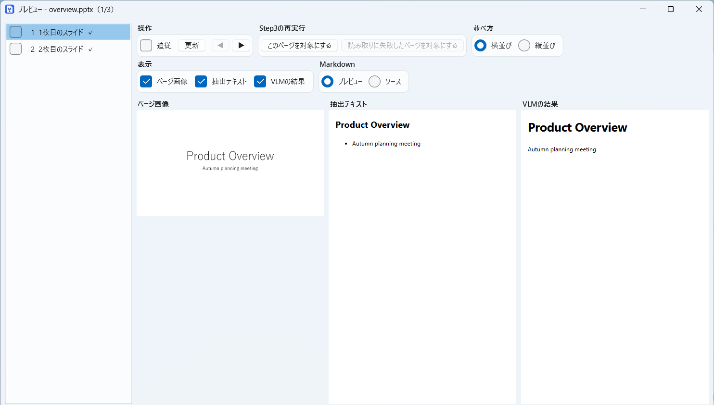
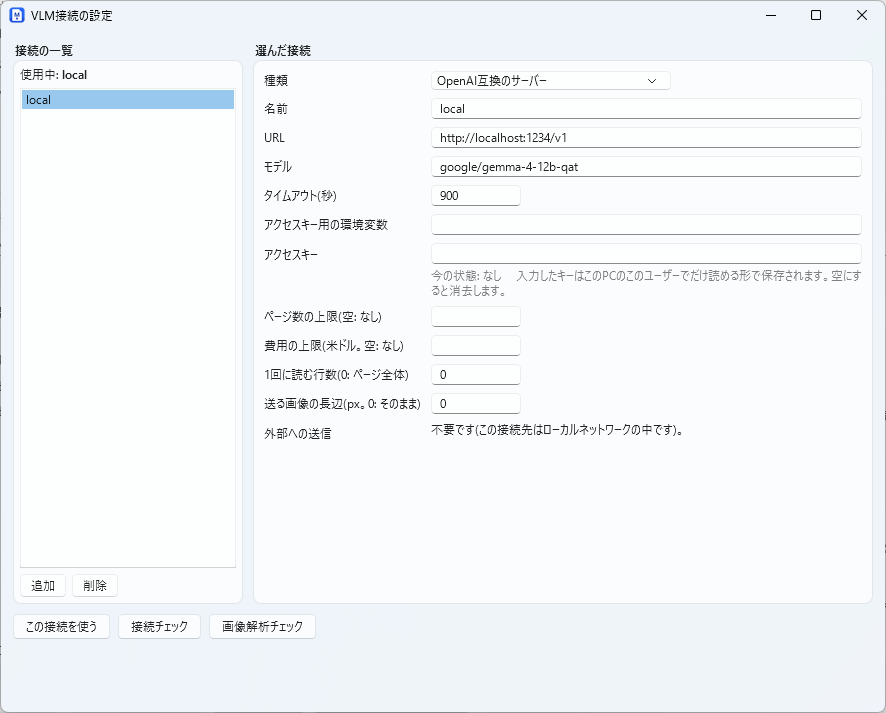

# 詳しい使い方

[README](../README.ja.md)

## 使い方

### 変換を始める

1. ファイルまたはフォルダを追加します。一覧へのドロップも使えます。
2. 出力先を選びます。
3. 「条件」で変換方法を設定します。
4. 「開始」を押します。

変換中は条件を変更できません。設定は `%APPDATA%\MarkPortO\settings.json` に保存され、次回の起動時に復元されます。

ファイルの一覧を読み込んでいる間は、右下に「処理中」と出ます。操作できるようになるまで0.3秒より長くかかるとき（大きなフォルダを追加した、出力先を変えた、など）は、ウィンドウの中央に「ファイルを読み込んでいます…」などと出て、終わるまで画面を操作できません。変換中は出ません（中断できるように）。

### 変換条件を選ぶ

#### プリセット

「条件」の一番上の「プリセット」で、目的に合わせたおすすめの設定（Step1〜3）をまとめて入れられます。入れたあとも、各設定は自由に変えられます。変えると、プリセットの名前の横に「（変更あり）」と出ます。

| プリセット | 向いている使い方 | 主な設定 |
|---|---|---|
| 閲覧用（`human`） | Officeの文書をやめて、Markdownで読み書きしたい | 太字・斜体を書く、画像・図形を取り出す、ページ画像は書かない、Step3は補足（図の中身を本文に足す）、冒頭の説明は書かない |
| RAG用（`rag`） | 文書をLLMやRAGに読ませたい | 太字・斜体は書かない、画像・図形を取り出す、ページ画像は参照のコメント（ページへたどれる）、Step3は補足、冒頭の説明を書く、RAG用の小分け（`_chunks.jsonl`）を書く |

- どちらも、表は「抽出テキストを採用」、「繰り返しの表を除く」はオン、VLMの結果は本文の中に書きます。
- Step3は、VLMの接続を選んでいるときだけオンになります（接続がなくても、プリセットを選んだだけで変換できなくなることはありません）。
- 入力、出力先、印刷エンジン、VLMの接続、対象の種類、Excelの範囲などは、プリセットでは変わりません。
- 「保存…」で、いまの設定を名前を付けたプリセットとして保存できます。「管理…」で名前の変更と削除ができます。組み込みのプリセットは変更・削除できません。
- CLIでは `--preset human|rag|<名前>` で選びます。一緒に指定したオプションは、プリセットより優先されます。
- 使ったプリセットの名前は、Markdownの冒頭のコメント（`<!-- converter: …; preset: rag -->`）に残ります。

「条件」は、上の「対象とオプション」（折りたためる部分）と、下のStep1〜3の行に分かれています。変換のたびに選ぶものはStepの行に、一度決めれば変えないものは折りたためる部分にあります。

| 場所 | 項目 | 設定する内容 |
|---|---|---|
| 対象とオプション | フォルダ内の対象 | ファイルの種類と、サブフォルダを含めるか。フォルダの出力（フォルダごと作る／中身だけを置く） |
| 〃 | 抽出方法 | 内蔵の処理、または外部コマンド（外部コマンドを登録したときに表示） |
| 〃 | 抽出オプション | Excelの範囲、シートごとに別ファイルにするかなど。外部コマンドを選ぶと無効になります |
| 〃 | ステップの詳細 | Step1: 印刷エンジン、DPI、太字・斜体。Step2: 印刷イメージの書き方。Step3: 結果を別ファイルに書く、表、繰り返しの表を除く。Markdown: 冒頭に「このMarkdownの構造」の説明を書く、RAG用の小分け（`_chunks.jsonl`）を書く |
| Stepの行 | Step1 | 文書の画像を取り出す、図形を画像にする、近くの図形をまとめる |
| 〃 | Step2 | Markdownへのページ画像の挿入 |
| 〃 | Step3 | VLM（画像を読めるモデル）による読み取り、VLMの使い方、接続、プロンプト、ページ範囲 |

### フォルダの出力とシートごとのファイル

- **フォルダの出力**（「フォルダ内の対象」の行。CLIは `--folder-layout`）: フォルダを追加したとき、「フォルダごと作る」（既定）は出力先にそのフォルダと同じ名前のフォルダを作り、その中に書きます。「中身だけを置く」はそのフォルダを作らず、中のファイルとサブフォルダを出力先の直下に作ります。フォルダを複数追加して同じ名前の文書があるときは、`名前 (2)` のように連番を付けます。ファイルを1つずつ追加したものは、どちらでも出力先の直下です。
- **シートごとに別ファイル**（Excel の行。CLIは `--excel-per-sheet on`）: ブックのフォルダの中に、シートごとの Markdown `<ブック名>_<シート名>.md` を書き、ブック全体の `<ブック名>.md` は書きません。ページ画像と図はブックで共有し、ページ番号はブック全体の通し番号のままです。VLM の結果の別ファイルと RAG 用の小分けも、シートごとに分けます。外部コマンドで抽出する xlsx には効きません。一覧の「Markdownを開く」は、出力フォルダを開きます。

```text
out/報告書/              # 「シートごとに別ファイル」のとき
├── 報告書_売上.md
├── 報告書_費用.md
└── images/              # page-001.png（売上）、page-002.png（費用）…
```

1ファイルだけを変換するときは、Step3の対象ページを絞れます。「ページ範囲」に `3-5,8` などを入力してください。

「対象とオプション」は折りたためます。折りたたむと、選んでいる設定の要約が1行で表示されます（エンジンとDPIのほかは、既定と違うものだけ）。Stepの行は常に表示されます。
ファイル一覧とページ一覧の高さは、間の境目をドラッグして調整できます。

ファイル一覧の「状態」には、色の点が付きます（緑: 完了、橙: 一部のページが失敗、赤: 失敗、Windowsのアクセントカラー: 実行中、灰: 待機中・中断）。Step3がページを読んでいる間は、Step3の列に進捗のバーが出ます。「VLM使用量」は合計のトークン数で、内訳（入力・出力）はポイントすると表示されます。変換中は、画面の下に全体の進捗（終わったファイルの数）が出ます。

### VLMで読み取る（Step3）

Step3は、Step1が文書から取り出した本文に、VLMで画像から読み取った内容を加える段階です。
Step3の項目は次のとおりです。

| 場所 | 項目 | 内容 |
|---|---|---|
| Step3の行 | VLMで印刷イメージからテキスト抽出 | Step3を使うかどうか。オフにすると、ほかの項目は隠れます。 |
| 〃 | VLMの使い方 | 「補足」（既定）か「書き写し」。下の説明を参照してください。 |
| 〃 | 接続 | 使うVLM接続。横の歯車のボタン（VLM接続の設定…）で登録します。 |
| 〃 | プロンプト | ファイルの種類ごとに、使うプロンプトを選びます。横の鉛筆のボタン（プロンプトの設定…）で編集します。 |
| ステップの詳細 | 結果を別ファイル（名前_vlm.md）に書く | オンにすると、VLMの結果を文書のMarkdown（`名前.md`）に入れず、`名前_vlm.md` に書きます。 |
| 〃 | 表 | ページ全体を読んだページで、VLMが書いた表をどうするか。下の「表の選択」を参照してください。 |
| 〃 | 繰り返しの表を除く | ページ全体を読んだページで、VLMが同じ表を2回以上書いたとき、2つ目以降を除きます。 |

VLMには、ページ画像（または図の画像）と、Step1で取り出した文字が送られます。外部のサービスを使う接続では、文書の画像と文字がネットワークの外へ送られます。

#### VLMの使い方：補足と書き写し

| 使い方 | 動作 | 向いている場面 |
|---|---|---|
| 補足（既定） | Step1の本文・表・コードをそのまま使い、VLMはStep1にないもの（図の中身）だけを読んで書き足します。 | Word・PowerPoint・Excelの文書。本文を正確に保ちたいとき。VLMの時間と費用を抑えたいとき。 |
| 書き写し | すべてのページの画像をVLMが読み、ページ全体を書き起こします（0.3.6までの動き）。 | Step1の抽出がうまくいかない文書。VLMの読み取りだけで資料を作りたいとき。 |

「補足」を勧めます。VLMにページ全体を書き写させると、Step1では正しかった文字をVLMが読み違えることがあります（例：「例外捕捉」が「例外捕脱」になる）。「補足」ではVLMに本文を書き直させないので、この読み違えが起きません。図は、ページ全体ではなく図だけを大きく渡すので、グラフの値なども正確に読めます。

#### 「補足」でのページの扱い

「補足」では、ページごとに読み方を決めます。

| ページの状態 | 読み方 | ページ一覧の「VLM読み取り」 |
|---|---|---|
| Step1で取り出した図（画像、図形）がある | 図を1つずつ、その図の画像と前後の文字と一緒に送ります。 | 完了（図） |
| Wordの図形（四角・円・矢印など）で、切り出していないものがある | 画像として保存されていないので、ページ画像を1回送り、図形だけを読ませます。ページの本文も一緒に送り、本文を繰り返さないようにします。 | 完了（図） |
| Step1の本文で足りる（図がない） | 送りません。 | 送らず（本文で足りる） |
| 前のページの続きだけ（表の行の折り返しや段落の最後が、改ページで押し出されたページ） | 送りません。Step1はその部分を前のページにまとめて書いています。 | 送らず（本文で足りる） |
| Step1の本文がほとんどない（20文字未満。文字が画像や図形の中にあるページなど） | ページ全体を書き写します。 | 完了 |
| 保存できなかった図（代替テキストだけ）がある | ページ全体を書き写します。 | 完了 |
| PDF、または外部コマンドで抽出した文書 | ページ全体を書き写します（Step1は表や見出しを作らないため）。 | 完了 |

次のページは、どちらの使い方でもVLMに送りません：削除ページ（×印）、空白ページ、ページ範囲の外のページ、「表」で「抽出テキストを採用」か「VLMの結果には残さない」を選んだときの、前のページの表の続きの行だけのページ（「表を結合済み」）。

送らなかったページの「VLM使用量」は「なし（送らず）」と表示します。1ページも送らなかった文書は、ファイル一覧の「VLM使用量」も「なし（送らず）」になります。「取得不可」は、送ったのにVLMが使用量を返さなかったときだけです。

#### 図の読み取りが書かれる場所

図の読み取りは、Markdownのその図の直後に、引用として書きます。図のすぐ次の段落が図表番号（「図1 …」「Figure 1 …」などの短い1行）なら、その後ろに書きます。Wordの図形の読み取りは、図形のあった段落の直後に書きます。

```markdown


図1 月ごとの応答時間

<!-- vlm:figure picture=pictures/page-001-1.png -->
> **図の読み取り（VLM）**
>
> - 7月: 196 ms
> - 8月: 183 ms
<!-- vlm:figure-end -->
```

VLMが「付け加えることはない」（`NONE`）と答えた図には、何も書きません。ページ全体を書き写したページは、これまでどおり `<!-- vlm:begin page=N -->` から `<!-- vlm:end -->` の間に書きます。

「結果を別ファイルに書く」をオンにすると、`名前_vlm.md` には、補足したページ・送らなかったページでも、Step1の本文と図を書き、図の読み取りを同じ形で足します。`名前_vlm.md` だけを読んでも、本文と図がそろいます。

#### 「補足」で使うための設定

- **Step1の「文書の画像を取り出す」をオンにしてください。** オフだと、文書に貼られた画像がファイルにならないので、図として読めません。代替テキストのある画像は `![代替テキスト]` だけが残るので、そのページはページ全体を書き写します。代替テキストのない画像は何も残らないので、読まれません。
- PowerPoint・Excelの図形（グループや、縦横0.5インチ以上の図形）は、Step1の「図形を画像にする」をオンにすると、画像として切り出され、図として読まれます。
- Wordの図形（図形やグループ、行内の描画キャンバス、表のセルの中の図形）も、「図形を画像にする」をオンにすると切り出されます。段落や行を基準に配置された図形は、PDF の中の段落の文字の位置を手がかりに、PDF の描画から位置を探します。確かに見つからないとき（段落の近くに図がない、横に並んだ図を見分けられない、など）は切り出さず、図形の中の画像（表のセルではテキストボックスの文字も）をそのまま書きます。オフのときも、Wordの図形はページ画像から読みます。古い形式（VML。互換モードの文書で描いた図形）は切り出しません（×印の判定には、その直線を読みます）。
- 「近くの図形をまとめる」がオンなら、縦の間隔が24ポイント以内（`settings.json` の `input.shapeGroupGapPoints`）の図形と画像、および横に離れていても同じ行にある図形と画像を1枚に切り出します。PowerPoint はスライドごと、Word はページごと（1つの段落の図形は、同じ基準で配置されていれば1枚。図形を1つずつ描くと別々の段落に付くので、いくつかの段落に分かれた図もまとめます）、Excel はシートごと（図形と、その間の小さな線・矢印）です。オフなら図形を1つずつ切り出し、画像はそのまま保存します。
- 図を読む指示は、「プロンプトの設定」の「図」のタブで変えられます（文書の種類によらず1つ）。`{pagetext}` は、図の前後の文字に置き換わります。ファイルの種類ごとのプロンプトは、ページ全体を書き写すときに使います。

#### 表の選択と「繰り返しの表を除く」

「表」と「繰り返しの表を除く」が効くのは、**ページ全体を読み取ったページだけ**です。「書き写し」のすべてのページと、「補足」でページ全体を読んだページ（PDFや、Step1の本文がほとんどないページなど）が該当します。

たとえば、Wordの同じページに料金表と画面の図があり、Step1が両方を取り出せたとします。「補足」では、料金表はStep1の内容のまま、図の読み取りは図の後ろに載ります。「表」で「VLMの結果を採用」を選んでいても、料金表をVLMに読み直させることはありません。図の読み取りに表が含まれていても、それは図の補足として表示されます。

| 「表」の選択 | ページ全体を読んだ結果のMarkdown |
|---|---|
| VLMの結果を採用 | ページ画像からVLMが読み取った表を載せます。ページをまたぐ表は、始まりのページにまとめて読ませます。 |
| 抽出テキストを採用 | 同じページにStep1の表があれば、VLM側の表をStep1の表に置き換えます。 |
| VLMの結果には残さない | 同じページにStep1の表があれば、VLM側では表を省き、本文の表を参照する注記を載せます。 |

Step1で表を抽出できなかったページでは、どの選択でもVLMが読み取った表が残ります。

**「繰り返しの表を除く」**は、その後で同じページのVLM結果の中を調べます。たとえばVLMが料金表を二度書いた場合は、最初の表を残して省略の注記を載せます。対象はデータ行が2行以上ある同内容の表です。Step1本文とVLM結果に料金表が一度ずつ載る場合に、VLM側を省きたいときは「VLMの結果には残さない」を選びます。

#### 設定を変えたあと

VLMの使い方、接続（モデル）、ファイルの種類ごとのプロンプトを変えたあとは、「Step3を再実行」で、前の設定で読んだページを読み直せます。Step1・Step2はやり直しません。

ただし、Wordの図形を読むための印はStep1で付けます。この機能より前に変換した文書でWordの図形を読ませるには、「Step1から再変換」してください。

### 結果を確認する

ファイルをダブルクリックすると、プレビューが開きます。
特定のページから確認するには、メイン画面で次のように操作します。

1. 上のファイル一覧で文書を選びます。下のページ一覧に、その文書のページが表示されます。
2. 見たいページの行（例：9ページ）を右クリックし、「プレビュー」を選びます。そのページを選択した状態でプレビューが開きます。
3. 同じ文書のプレビューがすでに開いていれば、そのウィンドウが指定ページに移動します。変換中もそのページを読めるよう、「追従」は解除されます。進捗に合わせて表示を移すには、「追従」を再びオンにします。

ページ画像・抽出テキスト・VLMの結果から、表示するものを選べます。
横並び・縦並びや、描画・ソース表示も切り替えられます。

| 操作 | 動作 |
|---|---|
| 「追従」 | 最後に読み終えたページを表示 |
| Ctrl＋ホイール | ページ画像を拡大・縮小 |
| Ctrl＋0 | 拡大率を100%に戻す |
| 左右の矢印キー | ページを移動 |
| マウスホイール | スクロールしてページ端で止まり、その後ページを移動 |
| 右ボタンでドラッグ | スクロール |
| ◀ ▶（Ctrl＋←・→） | 一覧の前・次のファイルに切り替え |

ページや結果が変わっても、拡大率とスクロール位置は保たれます。

#### 出来のよくないページをVLMで読み直す

1. プレビューのページ一覧で、読み直したいページのチェックボックスを入れます（「このページを対象にする」、「読み取りに失敗したページを対象にする」でも付けられます。失敗とは、VLMの応答がない・時間切れ・接続やサーバーのエラーで、状態が「失敗」のページです）。ファイル一覧の右クリックの「Step3の再実行対象にする」では、選んだファイルの全ページを一度に付けられます。印を付けたページは、ファイル一覧のStep3の列と、ページ一覧の「VLM読み取り」の列に「再実行待ち」と出ます。
2. メイン画面の「Step3を再実行」を押します。印を付けたページだけが、いまメイン画面で選んでいる接続とプロンプトで読み直され、結果が置き換わります。
3. 読み直しに失敗したページは、前の結果が残り、印も残ります。
4. 接続（モデル）や、ファイルの種類ごとのプロンプト、VLMの使い方を変えたあとは、印がなくても「Step3を再実行」が押せます。前と違う設定で読んだページが、いまの設定で読み直されます。



出力フォルダは、一覧の「出力先」列で確認できます。
右クリックメニューから、フォルダやMarkdownを開けます。

### 過去の出力を開く

1. 「ファイル → 過去の出力を開く…」を選びます。
2. 出力先フォルダ、または文書1つのフォルダを選びます。
3. 一覧から文書を選びます。複数の変換結果がある場合は、下の欄で選びます。
4. 「プレビュー」「エクスプローラで開く」「開く」のいずれかを押します。

文書と変換結果は、新しい順に並びます。
「開く」は選んだファイルと出力先をメイン画面に読み込みます。変換は始まりません。

Ctrl＋クリック、Shift＋クリックで複数の文書を選べます。
複数選択では、それぞれの最新結果が使われます。プレビューは1文書だけ選んだ場合に使えます。

出力の読み込みでは、ファイルを書き換えません。
別の場所へ移す場合は、管理情報の `.markporto` も一緒に移してください。
`.markporto` がない場合（文書のフォルダだけを写したときなど）は、各文書のフォルダの `conversion.json` から読みます。
プレビューと「開く」（新しい変換として）はできますが、再開はできません。

### 中断した変換を再開する

1. 「過去の出力を開く」で、再開したい変換結果を選びます。
2. 「開く」を押します。
3. メイン画面で「再開」を押します。

失敗を含む変換や、新しい変換を始めたために破棄された中断結果も選べます。
複数の文書を開いた場合も、未完了の文書が再開可能な変換に含まれていれば再開できます。

### 前回の状態に戻す

「変換するファイル・フォルダ」を選ぶと、前回の状態に戻ります。

- **ファイルの一覧**：入力のファイル1つずつに、出力先での最後の変換の状態を出します。入力の組が前回と違っても（前回はフォルダ A と B、今回は A だけ、など）、ファイルごとに戻ります。
- **出力先**：入力ごとに、変換した出力先を覚えています。今の出力先に記録がなければ、1つ目の入力を前回変換した出力先に切り替えます（状態の文でお知らせします）。出力先を自分で選び直したときは、次に入力を変えるまで切り替えません。
- **変換の条件**：1つ目の入力の、いちばん新しい変換の条件に戻します。プリセットの欄には「前回の条件」と出ます。戻した条件は、入力を選んだだけでは設定に保存しません。条件を変えるか、変換を始めると保存します。入力を空にすると、保存してある条件に戻ります。

「1つ目」は、入力の一覧の上から見て、記録のある最初の入力です。前回の出力先や条件が1つ目と違うファイル・フォルダを追加すると、確認が出ます。追加すると、出力先と条件は1つ目に合わせ、1つ目の出力先に記録のないファイルは新しく変換します。

覚えた出力先は、メニュー「設定」の「出力先の履歴を消す」で消せます。

### 変換し直す

| 一覧の状態 | 意味 |
|---|---|
| 未変換 | この出力先にまだ記録がありません |
| 完了・完了(一部失敗)・失敗 | 前回の変換の結果です |
| 未完了 | 中断したか、途中で終わりました |
| Step2 未実行・Step3 未実行 | 前回はその Step をオフで変換し、今はオンです |
| 変更あり | 前回の変換のあとで、ファイルが変わりました |
| ほかで実行中 | ほかのウィンドウや CLI が変換しています（どの操作の対象にもしません） |

- **開始**：一覧がすべて「未変換」のとき。入力のファイルをすべて変換します。
- **再開**：ファイルごとに続けます。「未完了」は続き、「失敗」「完了(一部失敗)」は失敗したファイルやページの再試行、「Step2/3 未実行」はその Step だけ、「未変換」は今の条件での新しい変換です。前回の変換が複数あっても、1回の「再開」で順に続けます。
- **すべてやり直し**：現在の条件ですべて変換し直します。
- **更新ファイルの再変換**：「変更あり」のファイルと新しいファイルを変換します。既存のファイルは前回のフォルダに書き込みます。

#### Step2 まで変換したファイルに Step3 だけを足す

1. 前回の入力を選びます（一覧と条件が前回の状態に戻ります）。
2. Step3 をオンにし、VLM の接続を選びます。一覧は「Step3 未実行」になります。
3. 「再開」を押します。Step1・Step2 はやり直さず、前回のフォルダで Step3 だけを実行し、Markdown を書き直します。

前回オンだった Step を今オフにしても、前回の結果は消えません。ファイルが変わっていた（「変更あり」）ときは、Step を足さずに Step1 から変換し直します。

「開始」と「すべてやり直し」の保存方法は、「同名フォルダ存在時は」のプルダウンで選びます。
「別名で新しく作る」か「上書きする」を選択してください。

一部だけ変換し直す場合は、一覧でファイルを選んで「Step1から再変換」を押します。
右クリックの「選択したファイルをStep1から再変換」でも同じ操作ができます。
**「Step1から再変換」では、前回のフォルダ内のMarkdownとページ画像が置き換わります。**

### 作業セット

入力・出力先・条件の一式に名前を付けて保存し、あとで同じ状態に戻せます。メニュー「ファイル」の「作業セットを保存…」「作業セットを開く」「作業セットの管理…」を使います。

- 開くと、今の入力・出力先・条件をいったん初期化してから、作業セットの状態にします。開いた条件は設定に保存します。
- 前回の変換の記録があれば、一覧はその状態になります。作業セットの条件が前回の変換と違う項目は、状態の文でお知らせします。
- 接続は名前だけを保存します。その名前の接続がもうないときは、接続を選び直してください。
- もうない入力は入れずに開きます。

### VLM接続とプロンプト

「設定」メニューから設定します。
プロンプトは、ファイルの種類ごとに名前を付けて複数保存できます。
小さいローカルモデル用とクラウドLLM用の例が用意されています。

使うプロンプトは、メイン画面か `--prompt <名前>` で選びます。
`{pagetext}` を入れると、Step1で抽出したページのテキストも画像と一緒に送ります。
「図」のタブは、「補足」で図を読むときの指示です（文書の種類によらず1つ。`{pagetext}` は図の前後の文字）。



### コマンドライン

```powershell
markporto-cli convert D:\docs\report.docx --out D:\out
markporto-cli convert D:\docs --out D:\out --types docx,xlsx --recurse
markporto-cli convert D:\docs --out D:\out --step3 on --settings settings.json   # VLMで読む
markporto-cli convert --resume --out D:\out                                      # 中断した変換を続ける
markporto-cli list-jobs --out D:\out
markporto-cli check-connection --settings settings.json
```

コマンド:

| コマンド | 内容 |
|---|---|
| `markporto-cli convert <パス...>` | ファイルやフォルダを変換します。 |
| `markporto-cli list-jobs --out <フォルダ>` | 出力先に残っているジョブの一覧（`--resume --job` で選ぶため）。 |
| `markporto-cli check-connection [--connection <名前>] [--image]` | VLM接続に届くこととモデルがあることを確かめます。`--image` は画像を読めることも確かめます。 |
| `markporto-cli list-connections` | `settings.json` のVLM接続の一覧（アクセスキーは表示しません）。 |
| `markporto-cli consent <名前> [--revoke]` | 接続や抽出コマンドが文書をローカルネットワークの外へ送ることに同意します（`--revoke` で取り消し）。 |

`--settings <ファイル>`（`settings.json` のパス。
既定は `%APPDATA%\MarkPortO\settings.json`）はすべてのコマンドで使えます。
`convert` のオプションは `settings.json` より優先され、指定しなければ設定のままです。


**変換する場所と対象**

| オプション | 内容 |
|---|---|
| `--out <フォルダ>` | 出力先。 |
| `--types docx,xlsx,pptx,pdf` | フォルダ内で変換する種類（カンマ区切り）。 |
| `--recurse` / `--no-recurse` | サブフォルダも対象にする／しない。 |
| `--changed-only` | 前回の変換から変わったファイル、未変換のファイル、完了していないファイルだけを、前と同じフォルダに変換します。 |
| `--same-folder on\|off` | on: すべてのファイルを変換し、前回の変換があるファイルは前回と同じフォルダに書き直します。off: ファイルごとに新しいフォルダを作ります。 |
| `--pages <範囲>` | 1ファイルのとき、Step3で読むページ。`3-5,8` のように（`8-` は8ページ目から、`-4` は4ページ目まで。`--pages=-4` と書く）。Step1はファイル全体を変換します。 |

**文書の読み取り（Step1）**

| オプション | 内容 |
|---|---|
| `--engine office\|libreoffice` | ページ画像を作る印刷エンジン。 |
| `--dpi <72-600>` | ページ画像の解像度。 |
| `--folder-layout folder\|contents` | フォルダを指定したときの出力の作り方: 入力フォルダの名前のフォルダを作る（既定）／作らずに中身だけを置く。`--resume` では使えません。 |
| `--excel-per-sheet on\|off` | Excelをシートごとに別のMarkdown（`<ブック名>_<シート名>.md`）にする（既定はoff）。 |
| `--excel-range columns\|sheet\|print-area` | Excelのシートをページに分ける方法: すべての列をできるだけ1ページに収める／全体を1シートに収める／印刷範囲設定に従う。 |
| `--include-hidden` / `--no-include-hidden` | 非表示のシートとスライドを含める／除く。`--include-hidden-sheets`、`--include-hidden-slides`（と `--no-` 付き）はどちらか一方だけを指定します。 |
| `--include-off-slide` / `--no-include-off-slide` | スライド外の図形の文字を書く（既定）／除く（pptx）。 |
| `--emphasis` / `--no-emphasis` | 太字を `**`、斜体を `*` で囲む（既定）／囲まない。 |
| `--pdf-text on\|off` | PDFの文字情報をページの本文に使う（VLMにも補助として渡す。既定はon）。 |
| `--pictures on\|off` | Word・PowerPoint・Excel の画像を `pictures/` に保存する（既定は設定ファイルのまま、初期値はoff）。Step3の「補足」で図を読むには on にします。 |
| `--shapes on\|off` | Word・PowerPoint・Excel の図形をページ画像から切り出して `pictures/` に保存する（既定はoff）。 |
| `--group-shapes on\|off` | `--shapes on` のとき、近くの図形・画像と、同じ行の図形・画像を1枚にまとめて切り出す。PowerPoint はスライド、Word はページ（いくつかの段落に分かれた図も）、Excel はシートの図形（既定はon）。 |
| `--extractor-docx\|xlsx\|pptx\|pdf <名前>` | その種類のファイルのMarkdownを書く抽出方法（`builtin` は内蔵）。 |

**Step2・Step3（VLM）**

| オプション | 内容 |
|---|---|
| `--step2 on\|off` | ページ画像を作り、Markdownに書く。 |
| `--page-image image\|reference\|link` | ページ画像の書き方（Step2のとき）。reference（既定）はコメント `<!-- page-image: images/page-001.png -->`（ビューアには表示されず、プログラムやモデルは読める）、image は ``（ビューアに表示される）、link は `[ページ 1](images/page-001.png)`（画像ではなくリンクが表示される）。 |
| `--preset human\|rag\|<名前>` | プリセット（Step1〜3のおすすめの設定）を使う。一緒に指定したオプションが優先。 |
| `--structure-note on\|off` | Markdownの冒頭に「このMarkdownの構造」の説明を書く（既定はon）。 |
| `--chunks on\|off` | RAG用の小分け `<名前>_chunks.jsonl` を書く（既定はoff、プリセット `rag` ではon）。下の「RAG用の小分け」を参照。 |
| `--step3 on\|off` | VLMで読み取る（読み方は `--step3-mode`）。 |
| `--step3-mode supplement\|transcribe` | Step3の使い方。supplement（既定）: Step1の本文を使い、図だけを読んで書き足す（本文がほとんどないページ・PDFはページ全体）。transcribe: すべてのページを書き写す。「VLMで読み取る（Step3）」の節を参照。 |
| `--connection <名前>` | 使うVLM接続。 |
| `--prompt <名前>` | VLMのプロンプト。その名前のプロンプトがあるすべての種類に使います（`standard` も可）。`--resume` では使いません。 |
| `--prompt-docx\|xlsx\|pptx\|pdf <名前>` | 1つの種類のVLMのプロンプト。 |
| `--vlm-separate on\|off` | Step3の結果を別ファイル `名前_vlm.md` に書く。 |
| `--step1-tables off\|replace\|omit` | ページ全体を読んだページで、ページの文字に表があるとき: VLMの表のまま（off）／文字の表に置き換える（replace）／省く（omit）。画面の「表」。 |
| `--drop-repeated-tables on\|off` | ページ全体を読んだページで、VLMが繰り返し書いた表を除く。 |
| `--max-pages <数>` | Step3がこの数のページを読んだら止める（送らなかったページは数えない）。 |
| `--max-cost <米ドル>` | Step3の費用がこの額になったら止める（コマンドが費用を返す場合）。 |
| `--parallel <数>` | 外部コマンドを同時に動かす数。 |

**実行と結果**

| オプション | 内容 |
|---|---|
| `--resume` | 中断した変換を続ける（`--out` と一緒に）。 |
| `--job <id>` | `--resume` と一緒に、続けるジョブ（`list-jobs` で確認）。 |
| `--retry-failed` | `--resume` と一緒に、失敗したファイルをもう一度変換する。 |
| `--result <ファイル>` | 結果をJSONでこのファイルに書く。 |
| `--quiet` | 進捗の表示を減らす。 |

終了コード: `0` 成功、`1` 一部のファイルが失敗、`2` 引数や設定が不正、`3` 開始前の確認に失敗（同意がない場合を含む）、`4` 利用上限・ログイン切れ・ページ数や費用の上限で停止（`--resume` で続ける）、`130` 中断。


### `settings.json`

```json
{
  "schemaVersion": 1,
  "input": { "paths": ["D:\\docs"], "recurse": true, "types": ["docx", "xlsx", "pptx", "pdf"], "includeHiddenSheets": false, "includeHiddenSlides": false, "includeOffSlideText": true },
  "output": { "folder": "D:\\out" },
  "ui": { "language": "system", "theme": "system" },
  "engine": { "kind": "office" },
  "images": { "dpi": 150 },
  "steps": { "step2": true, "step3": true, "step3Mode": "supplement" },
  "vlm": {
    "selected": "local",
    "connections": [
      { "name": "local", "baseUrl": "http://localhost:1234/v1", "model": "vision-model", "apiKeyEnv": "MARKPORTO_API_KEY", "timeoutSeconds": 120 }
    ]
  }
}
```

場所は、環境変数 `MARKPORTO_SETTINGS` で変えられます。
`input.shapeGroupGapPoints` は、「近くの図形をまとめる」で PowerPoint のスライド、Word のページ（いくつかの段落に分けて描かれた図）、Excel のシートの図形・画像を1枚にする縦の間隔（ポイント、既定24、0〜720）です。同じ行にあるものは離れていても1枚にします。画面にはありません。
アクセスキーは、値ではなく環境変数の*名前*（`apiKeyEnv`）を書きます。
画面で入力したキーは、現在のWindowsユーザーだけが読める形（DPAPI）で保存し、ログや出力には出ません。


### 外部コマンドにMarkdownを書かせる

MarkItDown・Docling・Pandocなどを使って、Markdownを作成できます。
使うツールは自分でインストールしてください。MarkPortOはインストールや更新を行いません。

#### PDFについて

MarkPortOの内蔵の抽出は、PDFの文字を簡単に取り出すだけです。見出しは本文とつながり、表はただの文字の並びになります。
PDFは、MarkItDownかDoclingに任せることをおすすめします。

- MarkItDown：速く、見出し・箇条書き・改行がよく残ります。
- Docling：表を最もよく表にし、スキャンしたPDFも読み取れます。時間はかかります。
- PandocはPDFを読み取れません。

外部コマンドを使っても、ページ画像の保存、Step3（VLM）での読み取り、プレビューは使えます。
スキャンしたPDFでコマンドが文字を返さないときも、Step3がオンならVLMが読み取ります（下の「内蔵の抽出との違い」を参照）。

#### 登録する

1. 「設定 > 抽出コマンドの設定」を開きます。
2. 名前、コマンド、引数を入力します。「ひな形…」から設定例も追加できます。
3. 必要に応じて、タイムアウトと環境変数を設定します。
4. 「試す…」で文書1つを変換し、結果を確認します。
5. メイン画面の「抽出方法」で、ファイルの種類ごとにコマンドを選びます。

CLIでは `--extractor-docx|xlsx|pptx|pdf <名前>` で指定します。
`builtin` を指定すると内蔵の抽出に戻ります。
登録内容は、次の例のように `settings.json` にも書けます。

#### 内蔵の抽出との違い

| 処理 | 外部コマンドを選んだ場合 |
|---|---|
| Step1 | ページ画像を保存し、テキスト抽出はコマンドに任せます |
| Step2 | コマンドのMarkdownにはページ画像を挿入しません |
| Step3 | ページ画像を読み、結果を `名前_vlm.md` に保存します |

Markdownは外部コマンドの出力をそのまま使います。
**ページ区切りやページ画像への参照は付きません。** 画像自体は `images/` に保存されます。

コマンドが文字を1つも返さなかったとき（スキャンしたPDFなど）は、Step3がオンなら失敗にせず、ページ画像をVLMに読ませます。Markdownにはその旨の注記が入り、文字は `名前_vlm.md` にだけ入ります。Step3がオフなら、そのファイルは失敗になります。

複数ページの表の結合や太字・斜体など、MarkPortOの抽出機能は適用されません。
非表示シートなどの内蔵抽出用オプションも無効になります。

ツールやバージョンによって結果が異なります。
サンプルでの確認はしていますが、すべての文書での動作を保証するものではありません。

#### 設定例

```json
"extractors": [
  { "name": "markitdown", "command": "markitdown", "args": ["{input}", "-o", "{output}"] },
  { "name": "docling", "command": "docling", "args": ["{input}", "--to", "md", "--image-export-mode", "placeholder", "--output", "{outdir}"], "timeoutSeconds": 600 }
],
"input": { "extractors": { "pdf": "docling" } }
```

#### 引数に使える値

| 値 | 意味 |
|---|---|
| `{input}` | 入力ファイル |
| `{output}` | 出力するMarkdownファイル |
| `{outdir}` | コマンド用の出力フォルダ |

`{outdir}` だけを渡す場合は、その中に作られた `.md` を読み込みます。
`"output": "stdout"` を指定すると、標準出力を読み込みます。

コマンドは `PATH` から探します。フルパスでも指定できます。
実行時はシェルを通さず、指定した引数を渡します。
ツールのバージョンによって引数が異なるため、先にコマンド単体で試してください。

インストール例：

```powershell
uv tool install "markitdown[all]"
uv tool install docling
winget install JohnMacFarlane.Pandoc
```

Pandocはdocxとpptxを読み取れます。PDFは読み取れません。
xlsxはセルの並びをそのまま表にします。

#### 文書を外部に送る場合

`"sendsExternally": true` を設定し、送信に同意する必要があります。
設定画面の「同意...」か、`markporto-cli consent <名前>` を使います。
同意を取り消す場合は `--revoke` を付けてください。

### `claude`・`codex`・`opencode` で読み取る

```json
{ "name": "cloud", "kind": "command", "command": "claude", "model": "haiku", "effort": "low", "parallel": 2, "maxPages": 200, "maxCostUsd": 3.0 }
```

ページ画像ごとに、空の一時フォルダで、コマンドを1回実行します。
**自分の設定・フック・メモリ・ツールは使いません。
** ページ数や費用の上限、利用上限、ログイン切れ、同じ失敗が3ページ続いたときは、停止します（再開できます）。


**ページの画像と、ページのテキストは、コマンドの先のサービスへ、ネットワークの外に送られ、費用がかかることがあります。
** 機密の文書には使わないでください。
このような接続（と、ローカルネットワークの外にあるOpenAI互換の接続）は、同意したあとだけ使います。
接続の設定の「同意...」を押すか、`markporto-cli consent <名前> --settings settings.json` を実行します（`--revoke` で取り消し）。


## 出力

```text
out/report/
├── report.md          # 元のファイル名と、構造の説明から始まります
├── report_vlm.md      # --vlm-separate on のときだけ: Step3の結果（「補足」のページは本文と図の読み取り）
├── report_chunks.jsonl # RAG用の小分けのときだけ: 検索のための塊（1行に1つ）
├── report.log         # ページごとの記録(大きさ、画像、削除ページ・空白ページ)、警告、失敗
├── conversion.json    # 変換の記録: 元のファイル、条件、状態、書いたファイル（下の節）
├── images/            # ページ画像（Step2）
│   ├── page-001.png
│   └── page-002.png
└── pictures/          # 文書の画像・切り出した図形（「文書の画像を取り出す」「図形を画像にする」のとき）
    └── page-001-1.png
```

図形で描いた×印がページのほぼ全体（縦横70%以上。Word は縦横60%以上）を覆うページは、削除ページとして、本文と画像の参照を書かず、`> **[削除ページ]**` で始まる引用だけを書きます。×印は、×の図形（乗算記号）1つか、交差する2本の斜線です。Word では、互換モードの文書で描いた古い形式（VML）の直線の×も判定します。×の図形の段落がありうるページのうち、PDF に実際に×が描かれたページだけを削除ページにします。見つからないときは、どのページも削除ページにしません（ページが消えないように）。文字の×や小さな×、手描きの×は判定しません（ページ全体を覆う手描きの図形があると、警告を出して普通に変換します）。

結合セルは notePM 方式で書きます（`<` は左のセル、`^` は上のセルと結合）。
取り消し線の付いた文字は、`~~文字~~` で囲んで書きます。
`<!-- page: N -->` の行が、各ページの始まりです。

### 変換の記録（`conversion.json`）

各文書のフォルダに、その文書をどう変換したかを書きます。フォルダだけを見ても、何をどの条件で変換し、どこまで済んだかが分かります。

- 中身: 元のファイル（絶対パス、追加したフォルダからの相対パス、大きさ、更新日時）、出力先、変換の条件（エンジン、DPI、Step1〜3、プリセットなど）、状態（Step1〜3 と全体: 変換中・完了・失敗・中断）、ページの数、書いたファイル（Excel をシートごとにしたときはシートとそのページ）。
- 書く時: 変換を始めたとき、各 Step が終わったとき、終わったとき・中断したとき。再開や変換し直しで書き直します。
- API キー、外部コマンドのパス、プロンプトの本文は書きません（接続はモデル名、プロンプトは名前だけ）。
- 再開などに使う正しい記録は、出力先の `.markporto` です。`conversion.json` はその写しです。
- **出力を人に渡すと、元のファイルのパス（あなたのフォルダ名）も渡ります**（ログ `report.log` の1行目と同じ）。

```json
{
  "schemaVersion": 1,
  "source": { "path": "D:\\設計書\\v1.2\\設計書.docx", "relativePath": "v1.2/設計書.docx", "kind": "docx" },
  "status": "completed",
  "steps": { "step1": "done", "step2": "done", "step3": "notApplicable" },
  "conditions": { "preset": "rag", "engine": "office", "dpi": 150, "step3": false }
}
```

（抜粋）

### RAG用の小分け（`_chunks.jsonl`）

「ステップの詳細」の「RAG 用の小分け（_chunks.jsonl）を書く」をオンにすると（プリセット「RAG用」では既定でオン、CLIは `--chunks on`）、Markdown の隣に、文書を検索（RAG）のための塊に分けたファイル `<名前>_chunks.jsonl` を書きます。Markdown を書き直すたびに（Step3 のあと、読み直し、再開など）書き直します。

- 1行に1つの JSON です（JSON Lines、UTF-8・BOMなし・改行はLF）。
- 塊は見出しで区切り、段落は1,500文字までまとめます。表とコードブロックは途中で切らず、それだけで1つの塊にします（大きい表は行で分け、どの塊も見出しの行から始めます）。ページをまたぐ表とコードは1つの塊です。
- 図の読み取り（Step3 の補足）は、その図と同じ塊に入ります。文字のないページ（スキャンなど）は、VLM の読み取りが塊になります。
- 冒頭の「このMarkdownの構造」、目次、削除ページ、ページの区切りなどのコメントは入れません。

| 項目 | 内容 |
|---|---|
| `schemaVersion` | 形式の版（今は `1`） |
| `id`・`prev`・`next` | 塊の ID（`c0001` から）と、前・次の塊の ID |
| `source`・`sourceModified` | 元のファイル名（フォルダは含めない）と、その更新日時（UTC） |
| `path` | 変換したフォルダからの相対パス（例: `v1.2/基本設計/設計書.docx`）。ファイルを直接追加した文書はファイル名 |
| `markdown` | 同じフォルダの Markdown のファイル名 |
| `headings` | 見出しの道筋（例: `["2. データモデル", "2. ジョブと再開状態"]`） |
| `kind` | `text`・`table`・`code`・`slide`・`page` |
| `pages`・`pageImages` | ページの範囲（例: `[6, 7]`）と、そのページ画像。外部コマンドで抽出した文書は `null` と空 |
| `sheet` | xlsx のシート名（xlsx のときだけ） |
| `text` | 塊の本文（Markdown） |

使い方の例（Python）: 塊を読み、検索で見つかった塊の出どころを示します。答えの根拠は `source` と `pages` で示し、モデルにページ番号を書かせないようにします（小さいモデルは、ないページを書くことがあります）。

```python
import json
chunks = [json.loads(line) for line in open("report/report_chunks.jsonl", encoding="utf-8")]
by_id = {c["id"]: c for c in chunks}
for c in chunks:
    if "再開" in c["text"]:
        pages = "-".join(map(str, sorted(set(c["pages"])))) if c["pages"] else "?"
        print(f'{c["source"]} p.{pages} / {" > ".join(c["headings"])}')
        # 前後の塊も渡すと、節が2つに分かれていても答えやすくなります: by_id[c["prev"]]、by_id[c["next"]]
```

### Claude Code などから検索する

ZIP の `tools\markporto-rag\` にある小さな MCP サーバー `markporto-rag` を Claude Code などの道具に登録すると、そのモデルが `_chunks.jsonl` を検索して、出どころ（元のファイル・ページ・見出し・ページ画像）つきで答えられます。データベースは要りません。

1. RAG用の小分けをオンにして変換します（上の節。プリセット「RAG用」ならオン）。
2. [uv](https://docs.astral.sh/uv/) を入れます（`winget install astral-sh.uv`）。MCP の部品は、初回の起動で uv が取ってきます（インターネットが要ります）。
3. 設定ファイル `%APPDATA%\MarkPortO\markporto-rag.json` を作ります（`tools\markporto-rag\markporto-rag.sample.json` を写して直します）。一番小さい設定は、検索するフォルダだけです:

   ```json
   { "roots": ["D:\\MarkPortO-out"] }
   ```

   既定では、LM Studio（`http://localhost:1234/v1`）の埋め込みのモデル `text-embedding-multilingual-e5-small` にもつなぎ、つながれば意味の検索も混ぜます。つながらないときは、キーワードだけで探します。ほかのモデルを使うときは、`embedding` を書きます。質問と塊の頭に付ける文字（`queryPrefix`・`passagePrefix`）は、モデルの説明書のとおりにします（e5 は `"query: "`・`"passage: "`、Nomic は下のとおり、いらないモデルは `""`）:

   ```json
   {
     "roots": ["D:\\MarkPortO-out"],
     "embedding": { "url": "http://localhost:11434/v1", "model": "nomic-embed-text", "queryPrefix": "search_query: ", "passagePrefix": "search_document: " }
   }
   ```

   クラウドの埋め込み（Voyage AI・OpenAI など）や並べ直しのモデルも使えます。そのときは塊の文字が PC の外へ送られます。書き方は `tools\markporto-rag\README.ja.md` の「クラウドの API」を見てください。

4. 道具に登録します。Claude Code の例（パスは展開したフォルダに合わせます）:

   ```
   claude mcp add --scope user markporto-rag -- uv run --no-project --with mcp --with numpy python C:\MarkPortO\tools\markporto-rag\server.py
   ```

   ほかの道具の書き方と、設定のすべての項目は [tools/markporto-rag/README.ja.md](../tools/markporto-rag/README.ja.md) にあります。
5. 道具に頼みます。例:「設計書から、中断した変換の再開の仕方を調べて。ページも示して」。モデルは `search_docs` で探し、必要なら `read_chunk` で前後の塊を読んで、ページを付けて答えます。ページ画像（`pageImages`）で原文を確かめられます。

- 文書は PC の外へ出ません（埋め込みの API をクラウドにしたときだけ、塊の文字がその API へ送られます）。
- 新しく変換したり変換し直したりすると、次の検索で自動で読み直します。同じ文書の古い出力が同じフォルダにあると、同じ内容が重なって見つかります。
- **版ごとにフォルダを作って管理している文書**: すべての版を検索の対象にすると、同じ節の版違いが上位を埋め、古い版で答えたり版を混ぜたりします。検索の対象（`roots`）は最新版の出力だけにするか、`search_docs` の `path`（例: `"v1.2"`）で版を絞って頼んでください（「v1.2 の設計書から…」）。版を見分けるため、変換は「フォルダごと作る」（既定）で行います。版の違いを見るときは、版ごとの Markdown を WinMerge などで比べます。

