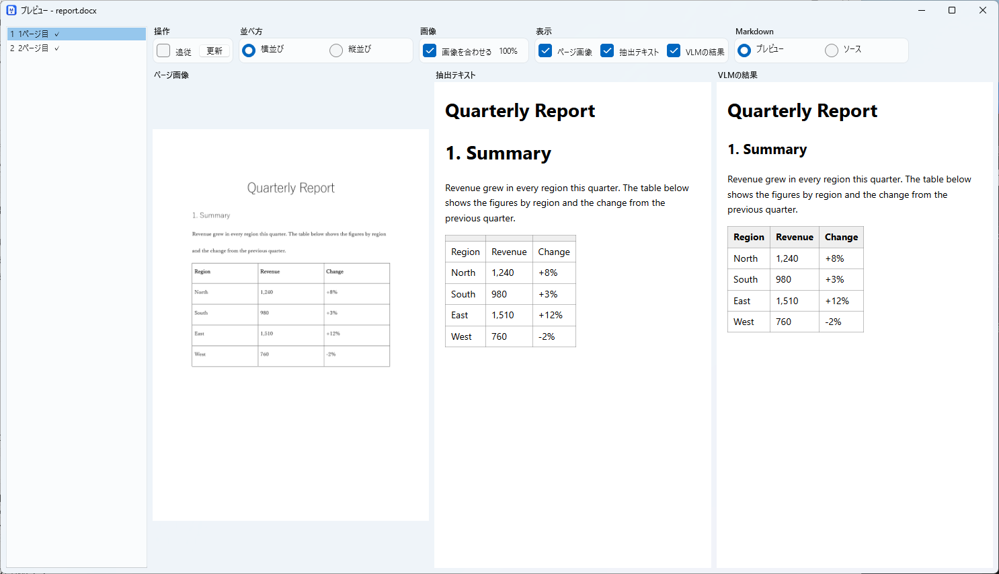
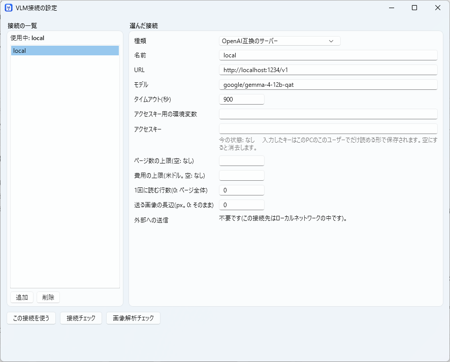

# 詳しい使い方

[README](../README.ja.md)

## 使い方

### 変換を始める

1. ファイルまたはフォルダを追加します。一覧へのドロップも使えます。
2. 出力先を選びます。
3. 「条件」で変換方法を設定します。
4. 「開始」を押します。

変換中は条件を変更できません。設定は `%APPDATA%\MarkPortO\settings.json` に保存され、次回の起動時に復元されます。

### 変換条件を選ぶ

| 項目 | 設定する内容 |
|---|---|
| 対象 | ファイルの種類と、サブフォルダを含めるか |
| 抽出方法 | 内蔵の処理、または外部コマンド |
| 種類ごとのオプション | Excelの範囲など。外部コマンドを選ぶと無効になります |
| Step1 | 印刷エンジン、DPI、太字・斜体、画像や図形の保存 |
| Step2 | Markdownへのページ画像の挿入 |
| Step3 | VLMによるページ画像の読み取り |

1ファイルだけを変換するときは、Step3の対象ページを絞れます。「ページ範囲」に `3-5,8` などを入力してください。

条件の上部は折りたためます。折りたたむと設定の要約が表示され、Stepの行は残ります。
ファイル一覧とページ一覧の高さは、間の境目をドラッグして調整できます。

### 結果を確認する

ファイルをダブルクリックすると、プレビューが開きます。
ページ画像・抽出テキスト・VLMの結果から、表示するものを選べます。
横並び・縦並びや、描画・ソース表示も切り替えられます。

| 操作 | 動作 |
|---|---|
| 「追従」 | 最後に読み終えたページを表示 |
| Ctrl＋ホイール | ページ画像を拡大・縮小 |
| Ctrl＋0 | 拡大率を100%に戻す |
| 左右の矢印キー | ページを移動 |
| マウスホイール | スクロールしてページ端で止まり、その後ページを移動 |
| 右ボタンでドラッグ | スクロール |
| ◀ ▶（Ctrl＋←・→） | 一覧の前・次のファイルに切り替え |

ページや結果が変わっても、拡大率とスクロール位置は保たれます。

#### 出来のよくないページをVLMで読み直す

1. プレビューのページ一覧で、読み直したいページのチェックボックスを入れます（「このページを対象にする」、「読み取りに失敗したページを対象にする」でも付けられます。失敗とは、VLMの応答がない・時間切れ・接続やサーバーのエラーで、状態が「失敗」のページです）。ファイル一覧の右クリックの「Step3の再実行対象にする」では、選んだファイルの全ページを一度に付けられます。印を付けたページは、ファイル一覧のStep3の列と、ページ一覧の「VLM読み取り」の列に「再実行待ち」と出ます。
2. メイン画面の「Step3を再実行」を押します。印を付けたページだけが、いまメイン画面で選んでいる接続とプロンプトで読み直され、結果が置き換わります。
3. 読み直しに失敗したページは、前の結果が残り、印も残ります。
4. 接続（モデル）や、ファイルの種類ごとのプロンプトを変えたあとは、印がなくても「Step3を再実行」が押せます。前と違う設定で読んだページが、いまの設定で読み直されます。



出力フォルダは、一覧の「出力先」列で確認できます。
右クリックメニューから、フォルダやMarkdownを開けます。

### 過去の出力を開く

1. 「ファイル → 過去の出力を開く…」を選びます。
2. 出力先フォルダ、または文書1つのフォルダを選びます。
3. 一覧から文書を選びます。複数の変換結果がある場合は、下の欄で選びます。
4. 「プレビュー」「エクスプローラで開く」「開く」のいずれかを押します。

文書と変換結果は、新しい順に並びます。
「開く」は選んだファイルと出力先をメイン画面に読み込みます。変換は始まりません。

Ctrl＋クリック、Shift＋クリックで複数の文書を選べます。
複数選択では、それぞれの最新結果が使われます。プレビューは1文書だけ選んだ場合に使えます。

出力の読み込みでは、ファイルを書き換えません。
別の場所へ移す場合は、管理情報の `.markporto` も一緒に移してください。

### 中断した変換を再開する

1. 「過去の出力を開く」で、再開したい変換結果を選びます。
2. 「開く」を押します。
3. メイン画面で「再開」を押します。

失敗を含む変換や、新しい変換を始めたために破棄された中断結果も選べます。
複数の文書を開いた場合も、未完了の文書が再開可能な変換に含まれていれば再開できます。

### 変換し直す

一覧には、現在の入力と出力先に対応する前回の変換が表示されます。
入力を変えると履歴を探し直し、該当する履歴がなければ一覧は空になります。
別の入力の履歴は「過去の出力を開く」から開いてください。

| 一覧の状態 | 押せるボタン |
|---|---|
| 前回の変換がない | 開始 |
| 未完了や失敗が残っている | 再開、すべてやり直し |
| すべて完了 | すべてやり直し、更新ファイルの再変換 |

- **開始**：入力のファイルをすべて変換します。
- **再開**：未完了の処理を続けます。失敗だけが残っている場合は、失敗したファイルやVLMのページを再処理します。
- **すべてやり直し**：現在の条件ですべて変換し直します。
- **更新ファイルの再変換**：変更されたファイルと新しいファイルを変換します。既存のファイルは前回のフォルダに書き込みます。

「開始」と「すべてやり直し」の保存方法は、「同名フォルダ存在時は」のプルダウンで選びます。
「別名で新しく作る」か「上書きする」を選択してください。

一部だけ変換し直す場合は、一覧でファイルを選んで「Step1から再変換」を押します。
右クリックの「選択したファイルをStep1から再変換」でも同じ操作ができます。
**「Step1から再変換」では、前回のフォルダ内のMarkdownとページ画像が置き換わります。**

### VLM接続とプロンプト

「設定」メニューから設定します。
プロンプトは、ファイルの種類ごとに名前を付けて複数保存できます。
小さいローカルモデル用とクラウドLLM用の例が用意されています。

使うプロンプトは、メイン画面か `--prompt <名前>` で選びます。
`{pagetext}` を入れると、Step1で抽出したページのテキストも画像と一緒に送ります。



### コマンドライン

```powershell
markporto convert D:\docs\report.docx --out D:\out
markporto convert D:\docs --out D:\out --types docx,xlsx --recurse
markporto convert D:\docs --out D:\out --step3 on --settings settings.json   # VLMで読む
markporto convert --resume --out D:\out                                      # 中断した変換を続ける
markporto list-jobs --out D:\out
markporto check-connection --settings settings.json
```

コマンド:

| コマンド | 内容 |
|---|---|
| `markporto convert <パス...>` | ファイルやフォルダを変換します。 |
| `markporto list-jobs --out <フォルダ>` | 出力先に残っているジョブの一覧（`--resume --job` で選ぶため）。 |
| `markporto check-connection [--connection <名前>] [--image]` | VLM接続に届くこととモデルがあることを確かめます。`--image` は画像を読めることも確かめます。 |
| `markporto list-connections` | `settings.json` のVLM接続の一覧（アクセスキーは表示しません）。 |
| `markporto consent <名前> [--revoke]` | 接続や抽出コマンドが文書をローカルネットワークの外へ送ることに同意します（`--revoke` で取り消し）。 |

`--settings <ファイル>`（`settings.json` のパス。
既定は `%APPDATA%\MarkPortO\settings.json`）はすべてのコマンドで使えます。
`convert` のオプションは `settings.json` より優先され、指定しなければ設定のままです。


**変換する場所と対象**

| オプション | 内容 |
|---|---|
| `--out <フォルダ>` | 出力先。 |
| `--types docx,xlsx,pptx,pdf` | フォルダ内で変換する種類（カンマ区切り）。 |
| `--recurse` / `--no-recurse` | サブフォルダも対象にする／しない。 |
| `--changed-only` | 前回の変換から変わったファイル、未変換のファイル、完了していないファイルだけを、前と同じフォルダに変換します。 |
| `--same-folder on\|off` | on: すべてのファイルを変換し、前回の変換があるファイルは前回と同じフォルダに書き直します。off: ファイルごとに新しいフォルダを作ります。 |
| `--pages <範囲>` | 1ファイルのとき、Step3で読むページ。`3-5,8` のように（`8-` は8ページ目から、`-4` は4ページ目まで。`--pages=-4` と書く）。Step1はファイル全体を変換します。 |

**文書の読み取り（Step1）**

| オプション | 内容 |
|---|---|
| `--engine office\|libreoffice` | ページ画像を作る印刷エンジン。 |
| `--dpi <72-600>` | ページ画像の解像度。 |
| `--excel-range columns\|sheet\|print-area` | Excelのシートをページに分ける方法: すべての列をできるだけ1ページに収める／全体を1シートに収める／印刷範囲設定に従う。 |
| `--include-hidden` / `--no-include-hidden` | 非表示のシートとスライドを含める／除く。`--include-hidden-sheets`、`--include-hidden-slides`（と `--no-` 付き）はどちらか一方だけを指定します。 |
| `--include-off-slide` / `--no-include-off-slide` | スライド外の図形の文字を書く（既定）／除く（pptx）。 |
| `--emphasis` / `--no-emphasis` | 太字を `**`、斜体を `*` で囲む（既定）／囲まない。 |
| `--pdf-text on\|off` | PDFの文字情報をVLMの補助に使う（既定はon）。 |
| `--pictures on\|off` | Word・PowerPoint・Excel の画像を `pictures/` に保存する（既定はoff）。 |
| `--shapes on\|off` | PowerPoint・Excel の図形をページ画像から切り出して `pictures/` に保存する（既定はoff）。 |
| `--extractor-docx\|xlsx\|pptx\|pdf <名前>` | その種類のファイルのMarkdownを書く抽出方法（`builtin` は内蔵）。 |

**Step2・Step3（VLM）**

| オプション | 内容 |
|---|---|
| `--step2 on\|off` | Markdownにページ画像を差し込む。 |
| `--step3 on\|off` | VLMでページ画像から文字を読み取る。 |
| `--connection <名前>` | 使うVLM接続。 |
| `--prompt <名前>` | VLMのプロンプト。その名前のプロンプトがあるすべての種類に使います（`standard` も可）。`--resume` では使いません。 |
| `--prompt-docx\|xlsx\|pptx\|pdf <名前>` | 1つの種類のVLMのプロンプト。 |
| `--vlm-separate on\|off` | Step3の結果を別ファイル `名前_vlm.md` に書く。 |
| `--step1-tables off\|replace\|omit` | ページの文字に表があるとき: VLMの表のまま（off）／文字の表に置き換える（replace）／省く（omit）。 |
| `--drop-repeated-tables on\|off` | VLMが同じページで繰り返し書いた表を除く。 |
| `--max-pages <数>` | Step3がこの数のページを読んだら止める。 |
| `--max-cost <米ドル>` | Step3の費用がこの額になったら止める（コマンドが費用を返す場合）。 |
| `--parallel <数>` | 外部コマンドを同時に動かす数。 |

**実行と結果**

| オプション | 内容 |
|---|---|
| `--resume` | 中断した変換を続ける（`--out` と一緒に）。 |
| `--job <id>` | `--resume` と一緒に、続けるジョブ（`list-jobs` で確認）。 |
| `--retry-failed` | `--resume` と一緒に、失敗したファイルをもう一度変換する。 |
| `--result <ファイル>` | 結果をJSONでこのファイルに書く。 |
| `--quiet` | 進捗の表示を減らす。 |

終了コード: `0` 成功、`1` 一部のファイルが失敗、`2` 引数や設定が不正、`3` 開始前の確認に失敗（同意がない場合を含む）、`4` 利用上限・ログイン切れ・ページ数や費用の上限で停止（`--resume` で続ける）、`130` 中断。


### `settings.json`

```json
{
  "schemaVersion": 1,
  "input": { "paths": ["D:\\docs"], "recurse": true, "types": ["docx", "xlsx", "pptx", "pdf"], "includeHiddenSheets": false, "includeHiddenSlides": false, "includeOffSlideText": true },
  "output": { "folder": "D:\\out" },
  "ui": { "language": "system", "theme": "system" },
  "engine": { "kind": "office" },
  "images": { "dpi": 150 },
  "steps": { "step2": true, "step3": true },
  "vlm": {
    "selected": "local",
    "connections": [
      { "name": "local", "baseUrl": "http://localhost:1234/v1", "model": "vision-model", "apiKeyEnv": "MARKPORTO_API_KEY", "timeoutSeconds": 120 }
    ]
  }
}
```

場所は、環境変数 `MARKPORTO_SETTINGS` で変えられます。
アクセスキーは、値ではなく環境変数の*名前*（`apiKeyEnv`）を書きます。
画面で入力したキーは、現在のWindowsユーザーだけが読める形（DPAPI）で保存し、ログや出力には出ません。


### 外部コマンドにMarkdownを書かせる

MarkItDown・Docling・Pandocなどを使って、Markdownを作成できます。
使うツールは自分でインストールしてください。MarkPortOはインストールや更新を行いません。

#### 登録する

1. 「設定 > 抽出コマンドの設定」を開きます。
2. 名前、コマンド、引数を入力します。「ひな形…」から設定例も追加できます。
3. 必要に応じて、タイムアウトと環境変数を設定します。
4. 「試す…」で文書1つを変換し、結果を確認します。
5. メイン画面の「抽出方法」で、ファイルの種類ごとにコマンドを選びます。

CLIでは `--extractor-docx|xlsx|pptx|pdf <名前>` で指定します。
`builtin` を指定すると内蔵の抽出に戻ります。
登録内容は、次の例のように `settings.json` にも書けます。

#### 内蔵の抽出との違い

| 処理 | 外部コマンドを選んだ場合 |
|---|---|
| Step1 | ページ画像を保存し、テキスト抽出はコマンドに任せます |
| Step2 | コマンドのMarkdownにはページ画像を挿入しません |
| Step3 | ページ画像を読み、結果を `名前_vlm.md` に保存します |

Markdownは外部コマンドの出力をそのまま使います。
**ページ区切りやページ画像への参照は付きません。** 画像自体は `images/` に保存されます。

複数ページの表の結合や太字・斜体など、MarkPortOの抽出機能は適用されません。
非表示シートなどの内蔵抽出用オプションも無効になります。

ツールやバージョンによって結果が異なります。
サンプルでの確認はしていますが、すべての文書での動作を保証するものではありません。

#### 設定例

```json
"extractors": [
  { "name": "markitdown", "command": "markitdown", "args": ["{input}", "-o", "{output}"] },
  { "name": "docling", "command": "docling", "args": ["{input}", "--to", "md", "--image-export-mode", "placeholder", "--output", "{outdir}"], "timeoutSeconds": 600 }
],
"input": { "extractors": { "pdf": "docling" } }
```

#### 引数に使える値

| 値 | 意味 |
|---|---|
| `{input}` | 入力ファイル |
| `{output}` | 出力するMarkdownファイル |
| `{outdir}` | コマンド用の出力フォルダ |

`{outdir}` だけを渡す場合は、その中に作られた `.md` を読み込みます。
`"output": "stdout"` を指定すると、標準出力を読み込みます。

コマンドは `PATH` から探します。フルパスでも指定できます。
実行時はシェルを通さず、指定した引数を渡します。
ツールのバージョンによって引数が異なるため、先にコマンド単体で試してください。

インストール例：

```powershell
uv tool install "markitdown[all]"
uv tool install docling
winget install JohnMacFarlane.Pandoc
```

Pandocはdocxとpptxを読み取れます。PDFは読み取れません。
xlsxはセルの並びをそのまま表にします。

#### 文書を外部に送る場合

`"sendsExternally": true` を設定し、送信に同意する必要があります。
設定画面の「同意...」か、`markporto consent <名前>` を使います。
同意を取り消す場合は `--revoke` を付けてください。

### `claude`・`codex`・`opencode` で読み取る

```json
{ "name": "cloud", "kind": "command", "command": "claude", "model": "haiku", "effort": "low", "parallel": 2, "maxPages": 200, "maxCostUsd": 3.0 }
```

ページ画像ごとに、空の一時フォルダで、コマンドを1回実行します。
**自分の設定・フック・メモリ・ツールは使いません。
** ページ数や費用の上限、利用上限、ログイン切れ、同じ失敗が3ページ続いたときは、停止します（再開できます）。


**ページの画像と、ページのテキストは、コマンドの先のサービスへ、ネットワークの外に送られ、費用がかかることがあります。
** 機密の文書には使わないでください。
このような接続（と、ローカルネットワークの外にあるOpenAI互換の接続）は、同意したあとだけ使います。
接続の設定の「同意...」を押すか、`markporto consent <名前> --settings settings.json` を実行します（`--revoke` で取り消し）。


## 出力

```text
out/report/
├── report.md          # 元のファイル名と、構造の説明から始まります
├── report_vlm.md      # --vlm-separate on のときだけ: Step3の結果
├── report.log         # ページごとの記録(大きさ、画像、削除ページ・空白ページ)、警告、失敗
└── images/
    ├── page-001.png
    └── page-002.png
```

結合セルは notePM 方式で書きます（`<` は左のセル、`^` は上のセルと結合）。
取り消し線の付いた文字は、`~~文字~~` で囲んで書きます。
`<!-- page: N -->` の行が、各ページの始まりです。

