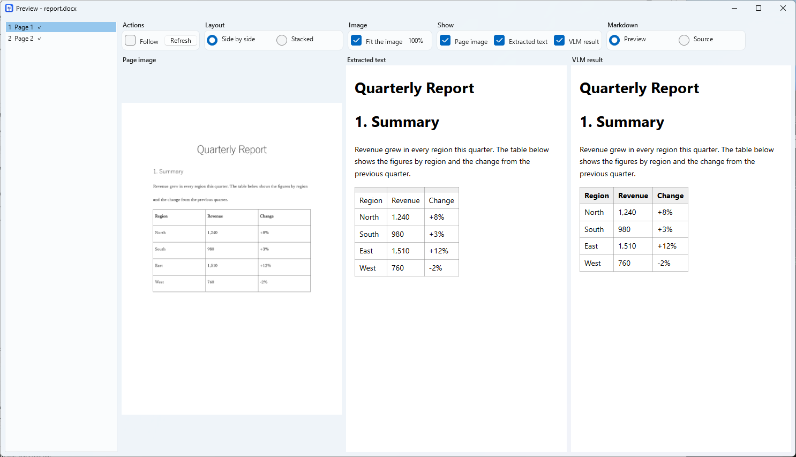
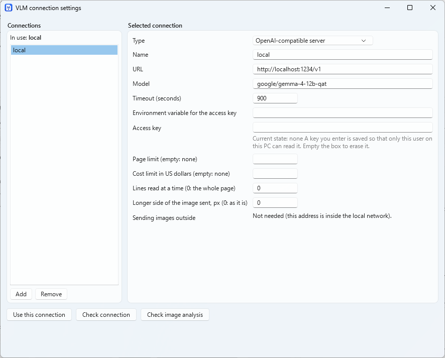

# Detailed usage

[README](../README.md)

## Usage

### Desktop app

Add files or a folder (or drop them on the list), choose an output folder, and press **Start**.

The **Conditions** have a row for the kinds of file in a folder (and sub-folders), a row for who extracts the text of each kind (built-in or an external command), the options of each kind (grey when an external command is chosen), and the steps.

The engine, the DPI, bold and italic, the pictures of the document and the shapes are in the row of Step1.

The upper part can be folded (a line then says what is chosen.

the steps stay in view).

The list of files and the list of pages share the height.

drag the bar between them to change it.

For one file, a **page range** (like `3-5,8`) limits the pages that Step3 reads.

The values are saved to `%APPDATA%\MarkPortO\settings.json` and restored at the next start.

**Preview** (double-click a file): choose which of the page image, the extracted text and the VLM result to show, side by side or stacked, drawn or as source.

**Follow** shows the page read last.

The page image zooms with Ctrl and the wheel (Ctrl and 0 is 100%).

the zoom and the scroll position are kept when the page changes or a new result arrives.

Arrow keys and the mouse wheel change the page (the wheel stops at the end of a page first).

dragging with the right button scrolls.

The ◀ ▶ buttons (Ctrl+Left, Ctrl+Right) go to the previous and next file of the list.

**Reading pages again with the VLM**: tick the check box of a page in the page list of the preview (or use "Mark this page" and "Mark failed pages"). The "Read again" column of the file list (shown while Step 3 is on) ticks every page of a file. Then press "Read again with the VLM" on the main screen: only the marked pages are read again, with the connection and the prompts chosen on the main screen, and the results are replaced. A page that fails again keeps its earlier result and its mark.



**Open a past output** (File > Open a past output...): choose the output folder (or the folder of one document).

MarkPortO reads the state it keeps in `.markporto` and lists the documents, newest run first.

a file converted more than once has its results (newest first) in the box below.

The buttons act on the result chosen there: **Preview**, **Open in Explorer**, and **Open**.

It only reads.

The output folder can be moved or copied to another place and still opens, as long as `.markporto` goes with it.

**Open** puts the selected files in the inputs and the file list of the main window and makes this the output folder.

it does not start a conversion.

Then press **Redo all**, or select files in the file list and press **Convert again** to write them into the same folders as before.

The same window can also **resume an earlier run**: pick the result in the box (an interrupted one, also one that was given up when a later conversion was started, or one with failures) and press **Open**.

the main window shows it as the previous conversion, and **Resume where it stopped** continues it.

Several files can be selected (Ctrl+click, Shift+click): the newest result of each is used (when a file that did not finish is in a run that can be resumed, that run can be resumed), and **Preview** is for one file only.

**VLM connections** and **prompts** are in the **Settings** menu.

Each kind of file can have several named prompts (a built-in one for a small local model and one for a cloud LLM are included).

choose one on the main screen or with `--prompt <name>`.

A prompt can contain `{pagetext}`, the text Step1 took from the page (it is sent with the image).



The list of files shows the folder of each document in the output (the **Output** column).

the right-click menu opens that folder, the Markdown, or the Markdown of the VLM results.

While a conversion runs the conditions cannot be changed.

**The buttons that convert**: the list of files decides which can be pressed.

The list shows the previous conversion, in the output folder, of the same inputs as those on the screen.

When the inputs change, the conversion of the new inputs is looked for, and the list is empty when there is none (a conversion of other inputs can be resumed from **Open a past output**).

| The list | Buttons |
|---|---|
| Empty (no earlier conversion in the output folder) | **Start** |
| A file is not done | **Resume where it stopped**, **Redo all** |
| Every file is done | **Redo all**, **Convert changed files only** |

- **Start**: converts every file of the inputs.
- **Resume where it stopped**: goes on with the previous conversion: the files that did not finish or, when only failures are left, the files that failed and the pages the VLM could not read.
- **Redo all**: converts every file of the inputs again with the conditions on the screen. Where a file that was converted before is written is chosen beside the buttons, under **When a file has an earlier folder** (**Make a new one** or **Overwrite**; it works for **Start** too).
- **Convert changed files only**: converts only the files that changed since their last conversion in the output folder, and the new ones, into the folders of their earlier conversion.

To convert some files again, select them in the file list (Ctrl+click, Shift+click) and press **Convert again** above the list, or choose **Convert the selected files again** from the right-click menu.

A file goes back to the folder of its earlier conversion: its Markdown and page images are replaced, so the paths stay the same.

### Command line

```powershell
markporto convert D:\docs\report.docx --out D:\out
markporto convert D:\docs --out D:\out --types docx,xlsx --recurse
markporto convert D:\docs --out D:\out --step3 on --settings settings.json   # read with a VLM
markporto convert --resume --out D:\out                                      # continue an interrupted run
markporto list-jobs --out D:\out
markporto check-connection --settings settings.json
```

#### Conversion options

Options override `settings.json`.

- `--settings`.
- `--out`.
- `--types`.
- `--recurse`.
- `--include-hidden` (or `--include-hidden-sheets`.
- `--include-hidden-slides`).
- `--emphasis` / `--no-emphasis` (bold and italic text between `**` and `*`).
- `--no-include-off-slide`.
- `--pdf-text on|off`.
- `--pictures on|off` (save the pictures of a Word, PowerPoint or Excel file in `pictures/`).
- `--shapes on|off` (cut the drawn shapes of a PowerPoint or Excel file out of the page image into `pictures/`).
- `--engine`.
- `--dpi`.
- `--pages <range>` (one file: the pages that Step3 reads, like `3-5,8`).
- `--excel-range columns|sheet|print-area`.
- `--step2 on|off`.
- `--step3 on|off`.
- `--vlm-separate on|off`.
- `--step1-tables off|replace|omit` (where the text of a page has a table, replace the tables of the VLM result with it, or leave them out).
- `--drop-repeated-tables on|off` (leave out the tables that the VLM wrote again on a page).
- `--result <file>`.
- `--resume`.
- `--retry-failed`.
- `--changed-only` (only the files that changed since their last conversion, into their earlier folders).
- `--same-folder on|off` (on converts every file and writes those converted before into the folders of their earlier conversion; off makes new folders).
- `--quiet`.
- `--max-pages`.
- `--max-cost`.
- `--parallel`.

Exit codes: `0` success, `1` some files failed, `2` invalid arguments or settings, `3` the checks before the run failed (including a missing consent), `4` stopped by a usage limit, a login or a limit of pages or cost (use `--resume`), `130` interrupted.

### `settings.json`

```json
{
  "schemaVersion": 1,
  "input": { "paths": ["D:\\docs"], "recurse": true, "types": ["docx", "xlsx", "pptx", "pdf"], "includeHiddenSheets": false, "includeHiddenSlides": false, "includeOffSlideText": true },
  "output": { "folder": "D:\\out" },
  "ui": { "language": "system", "theme": "system" },
  "engine": { "kind": "office" },
  "images": { "dpi": 150 },
  "steps": { "step2": true, "step3": true },
  "vlm": {
    "selected": "local",
    "connections": [
      { "name": "local", "baseUrl": "http://localhost:1234/v1", "model": "vision-model", "apiKeyEnv": "MARKPORTO_API_KEY", "timeoutSeconds": 120 }
    ]
  }
}
```

The location can be changed with the environment variable `MARKPORTO_SETTINGS`.

Write the *name* of an environment variable (`apiKeyEnv`) rather than a key.

a key typed in the app is stored so that only the current Windows user can decrypt it (DPAPI), and never appears in logs or output.

### An external command writes the Markdown

For a kind of file, the Markdown can be written by a program that you installed yourself (MarkItDown, Docling, Pandoc and so on).

MarkPortO does not install or update it.

it only runs it, without a shell, with the arguments that you give.

The result is the Markdown of the whole document, as the command wrote it, **with no page marks and no page image references** (the page images are still saved in `images/`, and the results of the VLM go to `name_vlm.md`).

The features of MarkPortO for that kind of file (tables over several pages, merged cells, bold and italic, and so on) do not apply.

It has been tried with MarkItDown, Docling and Pandoc on sample files, not with every tool, version or kind of document, and the results of the tools differ.

Check the Markdown that comes out (**Try…** in the settings runs a command on one file).

How the steps work with a command: Step1 saves the page images (as always) and the command writes the text.

Step2 does not put the images into the Markdown of a command.

Step3 reads the page images as usual, and its results go to `name_vlm.md`.

The options beside a kind of file (hidden sheets, the range of a sheet and so on) are for the built-in extraction, and are grayed out while a command is chosen.

Register the commands in **Settings > Extractor settings** (name, command, arguments, time-out, environment variables, consent to send documents outside, and **Try…** to run one on a file.

**Template…** adds the usual settings of MarkItDown, Docling or Pandoc), or write them in `settings.json` as below, and choose one for each kind of file (the field **Extractor** of the conditions, which appears when there are commands, or `--extractor-docx|xlsx|pptx|pdf <name>`.

`builtin` is the built-in one):

```json
"extractors": [
  { "name": "markitdown", "command": "markitdown", "args": ["{input}", "-o", "{output}"] },
  { "name": "docling", "command": "docling", "args": ["{input}", "--to", "md", "--image-export-mode", "placeholder", "--output", "{outdir}"], "timeoutSeconds": 600 }
],
"input": { "extractors": { "pdf": "docling" } }
```

`{input}` is the file, `{output}` the Markdown file to write, `{outdir}` a folder for the command (when only `{outdir}` is given, the `.md` file that the command writes there is read).

`"output": "stdout"` reads the standard output.

The command is found in the `PATH` (or give the full path), for example after `uv tool install "markitdown[all]"`, `uv tool install docling` or `winget install JohnMacFarlane.Pandoc`.

Pandoc reads docx and pptx well.

it does not read PDF, and it writes a sheet of xlsx as a plain grid of cells.

The arguments differ between versions of a tool: try the command by hand first.

A command that sends your documents outside the PC needs `"sendsExternally": true` and a consent: press **Agree...** in the extractor settings, or run `markporto consent <name>` (`--revoke` withdraws it).

### Reading with `claude`, `codex` or `opencode`

```json
{ "name": "cloud", "kind": "command", "command": "claude", "model": "haiku", "effort": "low", "parallel": 2, "maxPages": 200, "maxCostUsd": 3.0 }
```

For each page image the command is run once, in an empty temporary folder, **without your own settings, hooks, memory or tools**.

The conversion stops (and can be resumed) at a limit of pages or cost, a usage limit, a missing login, or three failures in a row.

**The page images, and the text of the pages, are sent to the service behind the command, outside your network, and charges may apply.** Do not use this for confidential documents.

Such a connection (and an OpenAI-compatible one outside the local network) is used only after you agree: press **Agree...** in the connection settings, or run `markporto consent <name> --settings settings.json` (`--revoke` withdraws it).

## Output

```text
out/report/
├── report.md          # starts with the source file name and a description of the structure
├── report_vlm.md      # only with --vlm-separate on: the results of Step3
├── report.log         # what was made of each page (size, image, deleted or blank page), the warnings and the failures
└── images/
    ├── page-001.png
    └── page-002.png
```

Merged table cells are written in the notePM style (`<` joins the cell on the left, `^` the cell above).

Text with a strikethrough is written as `~~text~~`.

A `<!-- page: N -->` line starts each page.

