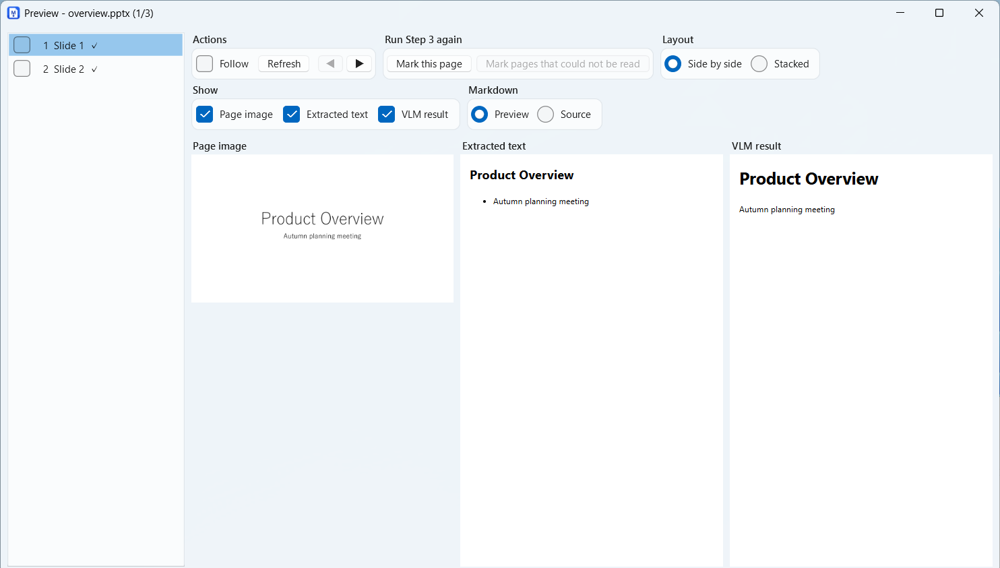
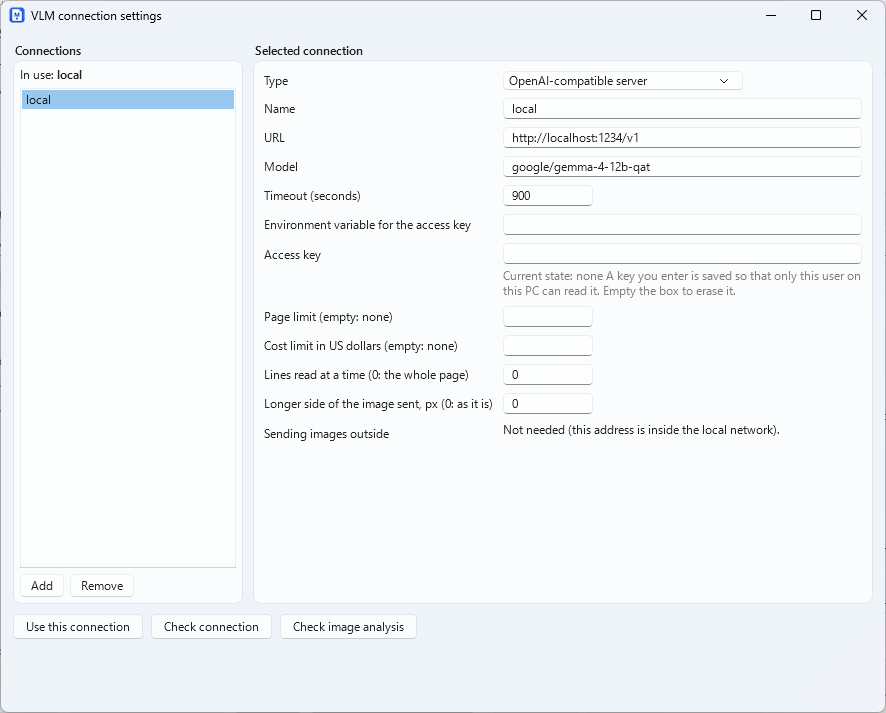

# Detailed usage

[README](../README.md)

## Usage

### Desktop app

1. Add files or a folder (or drop them on the list).
2. Choose an output folder.
3. Set the **Conditions**.
4. Press **Start**.

While a conversion runs, the conditions cannot be changed. The values are saved to `%APPDATA%\MarkPortO\settings.json` and restored at the next start.

#### Presets

**Preset**, at the top of the **Conditions**, puts the recommended settings of Step1 to Step3 for a purpose. They can still be changed afterwards; the name then shows "(changed)".

| Preset | For | Main settings |
|---|---|---|
| For reading (`human`) | Moving from Office documents to Markdown | bold and italic written, pictures and shapes saved, no page images in the Markdown, Step3 adds what the figures show, no description at the top |
| For RAG (`rag`) | Documents read by a language model | no bold and italic, pictures and shapes saved, the page images as comments (a passage can be traced to its page), Step3 adds what the figures show, the description at the top |

- Both use the tables of the extracted text, leave out repeated tables, and write the VLM results into the Markdown of the document.
- Step3 is turned on only when a VLM connection is chosen, so a preset never stops a conversion on a machine without one.
- The inputs, the output folder, the engine, the VLM connection, the kinds of file and the range of a sheet do not change.
- **Save…** saves the settings now as a preset with a name; **Manage…** renames and deletes them. The built-in presets cannot be changed or deleted.
- On the command line, `--preset human|rag|<name>`; the options given with it win over it.
- The name of the preset is in the comment at the top of the Markdown (`<!-- converter: …; preset: rag -->`).

The **Conditions** have a part that can be folded (**Kinds of file and options**) and the rows of Step1 to Step3. What is chosen for each run is in the rows of the steps; what is set once is in the part that can be folded.

| Where | Item | What it sets |
|---|---|---|
| Kinds of file and options | Kinds of file | The kinds of file in a folder, and whether sub-folders are included |
| 〃 | Extractor | Who extracts the text of each kind: built-in or an external command (shown when a command is registered) |
| 〃 | Extraction options | The range of an Excel sheet and so on (grey when an external command is chosen) |
| 〃 | Details of the steps | Step1: the engine, the DPI, bold and italic. Step2: how the page image is written. Step3: write the results to a separate file, tables, leave out repeated tables. Markdown: write "About this Markdown" at the top |
| Rows of the steps | Step1 | Save the pictures of the document, cut out the shapes, group the shapes that are near |
| 〃 | Step2 | Whether the page images are written in the Markdown |
| 〃 | Step3 | Reading with the VLM (a model that reads images), the use of the VLM, the connection, the prompts, the page range |

For one file, a **page range** (like `3-5,8`) limits the pages that Step3 reads.

Folded, **Kinds of file and options** shows in one line what is chosen (the engine and the DPI, and the other settings that are not the usual ones); the rows of the steps stay in view. The list of files and the list of pages share the height; drag the bar between them to change it.

The **State** of a file has a coloured mark: green done, orange some pages failed, red failed, the accent colour of Windows running, grey waiting or interrupted. While Step3 reads the pages of a file, a bar under its Step3 column shows how far it is. **VLM usage** shows the total of the tokens; point at it for the parts (prompt and completion). During a run, the bottom of the window shows how many files are finished.

### Reading with the VLM (Step3)

Step3 adds what a VLM reads in the images to the text that Step1 took from the document. The items of Step3 are:

| Where | Item | What it does |
|---|---|---|
| Row of Step3 | Extract text from print images with the VLM | Turns Step3 on or off. When it is off, the other items are hidden. |
| 〃 | Use of the VLM | **Add to the text** (the default) or **Read every page**. See below. |
| 〃 | Connection | The VLM connection to use. Set them up with the gear button beside it (**VLM connection settings…**). |
| 〃 | Prompt | The prompt for each kind of file. Edit them with the pencil button beside them (**Prompt settings…**). |
| Details of the steps | Write the results to a separate file (name_vlm.md) | The results of the VLM go to `name_vlm.md`, not into the Markdown of the document (`name.md`). |
| 〃 | Tables | What is done with the tables that the VLM wrote, on a page that it read whole. See "Tables and repeated tables" below. |
| 〃 | Leave out repeated tables | On a page that the VLM read whole, a table that it wrote twice or more is written once. |

The VLM is sent a page image (or the image of a figure) and the text that Step1 took from the document. With a connection to a service outside your network, the images and the text of your documents leave the network.

#### Use of the VLM: add to the text, or read every page

| Use | What it does | When to use it |
|---|---|---|
| Add to the text (default) | The text, tables and code of Step1 are kept as they are. The VLM reads only what Step1 does not have (what the figures show) and adds it. | Word, PowerPoint and Excel documents. When the text must stay exact. When the VLM should take less time and cost less. |
| Read every page | The VLM reads every page image and writes out the whole page (what Step3 did up to 0.3.6). | Documents that Step1 cannot extract well. When the result should come from the VLM only. |

**Add to the text** is recommended. When a VLM writes out a whole page, it can misread characters that Step1 had right. With **Add to the text** the VLM never writes the text again, so this does not happen. A figure is sent on its own, not as a small part of the page, so the values of a chart and so on are read more exactly.

#### How a page is read with "Add to the text"

With **Add to the text**, each page is read in one of these ways:

| The page | How it is read | "VLM" column of the page list |
|---|---|---|
| It has figures that Step1 saved (pictures, cut-out shapes) | Each figure is sent on its own, with the text before and after it. | Done (figures) |
| It has drawn shapes of Word (boxes, circles, arrows) | Word shapes are not saved as pictures, so the page image is sent once and the VLM is asked to read the shapes only. The text of the page is sent with it, so that the VLM does not write it again. | Done (figures) |
| The text of Step1 is enough (no figure) | Not sent. | Not sent (the text is enough) |
| It has only the rest of the page before (the end of a table row or of a paragraph pushed over the page break) | Not sent. Step1 writes that part with the page before. | Not sent (the text is enough) |
| Step1 has almost no text of it (fewer than 20 characters: the text is in an image or a shape, and so on) | The whole page is written out. | Done |
| It has a picture that could not be saved (only its alternative text) | The whole page is written out. | Done |
| A PDF, or a document that an external command extracted | The whole page is written out (Step1 makes no tables or headings for them). | Done |

These pages are never sent, whichever the use: deleted pages (an X over the page), blank pages, pages outside the page range, and, when **Tables** is **use the extracted text** or **do not keep in the VLM result**, a page with only the rest of a table of the page before ("Joined table").

For a page that was not sent, the **VLM usage** column says "none (not sent)". When no page of a document was sent, the file list says "none (not sent)" too. "unavailable" means that a page was sent but the VLM did not tell its usage.

#### Where what was read in a figure is written

What the VLM read in a figure is written as a quote right after the figure in the Markdown. When the paragraph right after the figure is its caption (one short line such as "Figure 1 …" or "図1 …"), it is written after the caption. What was read in the shapes of a Word page is written after the paragraph that the shapes are with.

```markdown


Figure 1. Response time by month

<!-- vlm:figure picture=pictures/page-001-1.png -->
> **What the VLM read in the figure**
>
> - July: 196 ms
> - August: 183 ms
<!-- vlm:figure-end -->
```

Nothing is written for a figure when the VLM answered that it has nothing to add (`NONE`). A page that was written out whole is between `<!-- vlm:begin page=N -->` and `<!-- vlm:end -->`, as before.

With **Write the results to a separate file**, `name_vlm.md` has the text of Step1 and the figures also on the pages that the VLM added to or did not read, with what was read in the figures in the same form. Read alone, `name_vlm.md` has the text and the figures.

#### Settings for "Add to the text"

- **Turn on "Save the pictures of the document" in Step1.** When it is off, the pictures of the document are not saved as files, so they cannot be read as figures. A picture with an alternative text leaves only `![alternative text]`, and its page is written out whole; a picture without one leaves nothing, and is not read.
- The shapes of PowerPoint and Excel (groups, and shapes of half an inch or more) are cut out of the page image as pictures with **Cut out the shapes** in Step1, and are then read as figures.
- The shapes of Word are read from the page image, whatever these settings. Shapes of the old kind (VML) are not read.
- The instruction for the figures is in the **Figures** tab of the prompt settings (one for every kind of file). `{pagetext}` in it is replaced by the text before and after the figure. The prompt of each kind of file is used when a page is written out whole.

#### Tables and repeated tables

**Tables** and **Leave out repeated tables** apply **only to a page that the VLM read whole**: every page with **Read every page**, and with **Add to the text** the pages that are written out whole (PDF, pages that Step1 has almost no text of, and so on).

Suppose a Word page contains a price table and a screenshot, and Step1 extracts both. With **Add to the text**, the Markdown keeps the Step1 price table and adds what was read in the screenshot after it. Selecting **use the VLM result** does not send the price table to the VLM. If what was read in the figure contains a table, it stays with the figure.

| Tables setting | Markdown for a page read whole |
|---|---|
| use the VLM result | Include the table the VLM read from the page image. A table that runs over pages is read as one, on the page where it starts. |
| use the extracted text | Where Step1 extracted a table on this page, replace the VLM tables with the Step1 tables. |
| do not keep in the VLM result | Where Step1 extracted a table on this page, omit the VLM tables and add a note pointing to the tables in the document text. |

If Step1 extracted no table on that page, all three settings keep the tables the VLM read.

**Leave out repeated tables** then checks the VLM output for that page. If the model wrote the same price table twice, the Markdown keeps the first copy and marks the omission. This applies to tables with at least two data rows. If the price table appears once in the document text and once in the VLM result, choose **do not keep in the VLM result** to omit the second one.

#### After changing the settings

After the use of the VLM, the connection (the model) or a prompt is changed, **Run Step 3 again** reads again the pages that were read with the earlier settings. Step1 and Step2 are not done again.

The mark that lets Step3 read the shapes of a Word page is made by Step1. To have the shapes of a document converted before this feature read, press **Convert again from Step 1**.

### Checking the results

**Preview** (double-click a file): choose which of the page image, the extracted text and the VLM result to show, side by side or stacked, drawn or as source. **Follow** shows the page read last.

To preview a specific page, select the document in the file list of the main window. In the page list below it, right-click the row you want (for example, page 9) and choose **Preview**. The preview opens on that page. If the document already has a preview window, that window moves to the selected page. Opening a specific page turns **Follow** off, so you can keep reading during a conversion; turn **Follow** on again to track the progress.

| Action | What it does |
|---|---|
| Ctrl + wheel | Zooms the page image |
| Ctrl + 0 | Zoom back to 100% |
| Left and right arrow keys | Change the page |
| Mouse wheel | Scrolls, stops at the end of a page first, then changes the page |
| Drag with the right button | Scrolls |
| ◀ ▶ (Ctrl+Left, Ctrl+Right) | The previous and the next file of the list |

The zoom and the scroll position are kept when the page changes or a new result arrives.

#### Reading pages again with the VLM

1. Tick the check box of a page in the page list of the preview (or use **Mark this page** and **Mark pages that could not be read**: a page fails when the VLM gives no answer, times out, or the connection or the server gives an error). The right-click menu of the file list (**Mark for running Step 3 again**) marks every page of the selected files. Marked pages show "Waiting to run again" in the Step3 column of the file list and in the VLM column of the page list.
2. Press **Run Step 3 again** on the main screen. Only the marked pages are read again, with the connection and the prompts chosen on the main screen, and the results are replaced.
3. A page that fails again keeps its earlier result and its mark.
4. After the connection, a prompt or the use of the VLM is changed, **Run Step 3 again** can be pressed without marks: it reads again the pages that were read with the earlier settings.



The list of files shows the folder of each document in the output (the **Output** column). The right-click menu opens that folder, the Markdown, or the Markdown of the VLM results.

### Opening a past output

1. Choose **File > Open a past output...**.
2. Choose the output folder, or the folder of one document.
3. Choose a document in the list. A file converted more than once has its results (newest first) in the box below.
4. Press **Preview**, **Open in Explorer** or **Open**.

Documents and results are listed newest first. **Open** puts the selected files in the inputs and the file list of the main window and makes this the output folder; it does not start a conversion.

Several documents can be selected (Ctrl+click, Shift+click): the newest result of each is used. **Preview** is for one document only.

Opening an output only reads it. The output folder can be moved or copied to another place and still opens, as long as `.markporto` goes with it.

### Resuming an interrupted conversion

1. In **Open a past output**, choose the result to resume.
2. Press **Open**.
3. Press **Resume** in the main window.

A result with failures, and an interrupted one that was given up when a later conversion was started, can be chosen too. When several documents are opened, the run can be resumed if a document that did not finish is in it.

### Converting again

The list shows the previous conversion, in the output folder, of the same inputs as those on the screen. When the inputs change, the conversion of the new inputs is looked for, and the list is empty when there is none (a conversion of other inputs can be opened from **Open a past output**).

| The list | Buttons |
|---|---|
| Empty (no earlier conversion in the output folder) | **Start** |
| A file is not done, or failed | **Resume**, **Redo all** |
| Every file is done | **Redo all**, **Reconvert updated files** |

- **Start**: converts every file of the inputs.
- **Resume**: goes on with the previous conversion: the files that did not finish or, when only failures are left, the files that failed and the pages the VLM could not read.
- **Redo all**: converts every file of the inputs again with the conditions on the screen.
- **Reconvert updated files**: converts only the files that changed since their last conversion, and the new ones, into the folders of their earlier conversion.

Where **Start** and **Redo all** write a file that was converted before is chosen beside the buttons, under **If the folder exists** (**Make a new one** or **Overwrite**).

To convert some files again, select them in the file list and press **Convert again from Step 1**, or choose **Convert the selected files again from Step 1** from the right-click menu. **The Markdown and the page images in the earlier folder are replaced**, so the paths stay the same.

### VLM connections and prompts

They are in the **Settings** menu. Each kind of file can have several named prompts (a built-in one for a small local model and one for a cloud LLM are included); choose one on the main screen or with `--prompt <name>`.

A prompt can contain `{pagetext}`, the text Step1 took from the page (it is sent with the image). The **Figures** tab is the instruction for reading a figure with **Add to the text** (one for every kind of file; `{pagetext}` is the text before and after the figure).



### Command line

```powershell
markporto-cli convert D:\docs\report.docx --out D:\out
markporto-cli convert D:\docs --out D:\out --types docx,xlsx --recurse
markporto-cli convert D:\docs --out D:\out --step3 on --settings settings.json   # read with a VLM
markporto-cli convert --resume --out D:\out                                      # continue an interrupted run
markporto-cli list-jobs --out D:\out
markporto-cli check-connection --settings settings.json
```

| Command | What it does |
|---|---|
| `markporto-cli convert <paths...>` | Converts files and folders. |
| `markporto-cli list-jobs --out <folder>` | Lists the jobs left in the output folder (to choose one with `--resume --job`). |
| `markporto-cli check-connection [--connection <name>] [--image]` | Checks that the VLM connection answers and has the model; `--image` also checks that it reads an image. |
| `markporto-cli list-connections` | Lists the VLM connections of `settings.json` (no access key is shown). |
| `markporto-cli consent <name> [--revoke]` | Agrees that a connection or an extractor sends documents outside the local network (`--revoke` withdraws it). |

`--settings <file>` (the path of `settings.json`; the default is `%APPDATA%\MarkPortO\settings.json`) works with every command. The options of `convert` override `settings.json`; an option that is not given keeps the setting.

**Where and what**

| Option | What it does |
|---|---|
| `--out <folder>` | The output folder. |
| `--types docx,xlsx,pptx,pdf` | The kinds of file to convert in a folder (comma-separated). |
| `--recurse` / `--no-recurse` | Include sub-folders, or not. |
| `--changed-only` | Only the files that changed since their last conversion, the new ones and the ones that did not finish, into their earlier folders. |
| `--same-folder on\|off` | on: converts every file and writes those converted before into the folders of their earlier conversion. off: makes a new folder for each file. |
| `--pages <range>` | For one file: the pages that Step3 reads, like `3-5,8` (`8-` is from page 8, `-4` is up to page 4; write `--pages=-4`). Step1 still converts the whole file. |

**Reading the document (Step1)**

| Option | What it does |
|---|---|
| `--engine office\|libreoffice` | The engine that prints the page images. |
| `--dpi <72-600>` | The resolution of the page images. |
| `--excel-range columns\|sheet\|print-area` | How an Excel sheet is cut into pages: every column on one page if possible / the whole sheet on one page / its print area. |
| `--include-hidden` / `--no-include-hidden` | Include the hidden sheets and slides, or not. `--include-hidden-sheets` and `--include-hidden-slides` (and their `--no-` forms) set only one of them. |
| `--include-off-slide` / `--no-include-off-slide` | Write the text of the shapes outside a slide (the default), or not (pptx). |
| `--emphasis` / `--no-emphasis` | Write bold text between `**` and italic text between `*` (the default), or not. |
| `--pdf-text on\|off` | Use the text layer of a PDF as the text of its pages (it also helps the VLM; the default is on). |
| `--pictures on\|off` | Save the pictures of a Word, PowerPoint or Excel file in `pictures/` (the default is the settings file; off at first). Turn it on for Step3 to read figures with **Add to the text**. |
| `--shapes on\|off` | Cut the drawn shapes of a PowerPoint or Excel file out of the page image into `pictures/` (the default is the settings file; off at first). |
| `--group-shapes on\|off` | With `--shapes on`: cut the shapes and pictures of a PowerPoint file that are near one another, or on the same row, out as one picture (the default is on). |
| `--extractor-docx\|xlsx\|pptx\|pdf <name>` | The extractor that writes the Markdown of that kind of file (`builtin` is the built-in one). |

**Step2 and Step3 (VLM)**

| Option | What it does |
|---|---|
| `--step2 on\|off` | Make the page images and write them in the Markdown. |
| `--page-image image\|reference\|link` | How the page image is written (with Step2). `reference` (the default) is a comment `<!-- page-image: images/page-001.png -->` that a Markdown viewer does not show but a program or a model can read; `image` is ``, which a viewer shows; `link` is `[Page 1](images/page-001.png)`, a link that a viewer shows instead of the image. |
| `--preset human\|rag\|<name>` | Use a preset (the recommended settings of Step1 to Step3). The options given with it win over it. |
| `--structure-note on\|off` | Write "About this Markdown" at the top of the Markdown (the default is on). |
| `--step3 on\|off` | Read with the VLM (how: `--step3-mode`). |
| `--step3-mode supplement\|transcribe` | How Step3 uses the VLM. supplement (the default): keep the text of Step1 and read only the figures, and add what they show (a page that Step1 has almost no text of, and a PDF, are written out whole). transcribe: write out every page. See "Reading with the VLM (Step3)". |
| `--connection <name>` | The VLM connection to use. |
| `--prompt <name>` | The prompt for every kind of file that has a prompt of this name (or `standard`). Not used with `--resume`. |
| `--prompt-docx\|xlsx\|pptx\|pdf <name>` | The prompt for one kind of file. |
| `--vlm-separate on\|off` | Write the results of Step3 to a separate file, `name_vlm.md`. |
| `--step1-tables off\|replace\|omit` | On a page read whole, where the text of the page has a table: keep the VLM tables (off) / replace them with the tables of the text (replace) / leave them out (omit). **Tables** on the screen. |
| `--drop-repeated-tables on\|off` | On a page read whole, leave out the tables that the VLM wrote again. |
| `--max-pages <number>` | Stop after Step3 has read this many pages (pages that were not sent are not counted). |
| `--max-cost <US dollars>` | Stop when the cost of Step3 reaches this (when the command tells the cost). |
| `--parallel <number>` | How many external commands run at the same time. |

**Running and the result**

| Option | What it does |
|---|---|
| `--resume` | Continue an interrupted run (with `--out`). |
| `--job <id>` | With `--resume`: the job to continue (see `list-jobs`). |
| `--retry-failed` | With `--resume`: convert the files that failed again. |
| `--result <file>` | Write the result as JSON to this file. |
| `--quiet` | Show less progress. |

Exit codes: `0` success, `1` some files failed, `2` invalid arguments or settings, `3` the checks before the run failed (including a missing consent), `4` stopped by a usage limit, a login or a limit of pages or cost (use `--resume`), `130` interrupted.

### `settings.json`

```json
{
  "schemaVersion": 1,
  "input": { "paths": ["D:\\docs"], "recurse": true, "types": ["docx", "xlsx", "pptx", "pdf"], "includeHiddenSheets": false, "includeHiddenSlides": false, "includeOffSlideText": true },
  "output": { "folder": "D:\\out" },
  "ui": { "language": "system", "theme": "system" },
  "engine": { "kind": "office" },
  "images": { "dpi": 150 },
  "steps": { "step2": true, "step3": true, "step3Mode": "supplement" },
  "vlm": {
    "selected": "local",
    "connections": [
      { "name": "local", "baseUrl": "http://localhost:1234/v1", "model": "vision-model", "apiKeyEnv": "MARKPORTO_API_KEY", "timeoutSeconds": 120 }
    ]
  }
}
```

The location can be changed with the environment variable `MARKPORTO_SETTINGS`. Write the *name* of an environment variable (`apiKeyEnv`) rather than a key. A key typed in the app is stored so that only the current Windows user can decrypt it (DPAPI), and never appears in logs or output.

### An external command writes the Markdown

For a kind of file, the Markdown can be written by a program that you installed yourself (MarkItDown, Docling, Pandoc and so on). MarkPortO does not install or update it; it only runs it, without a shell, with the arguments that you give.

#### Registering a command

1. Open **Settings > Extractor settings**.
2. Enter a name, the command and its arguments. **Template…** adds the usual settings of MarkItDown, Docling or Pandoc.
3. Set a time-out and environment variables if needed.
4. Press **Try…** to convert one document and check the result.
5. Choose the command for each kind of file in the **Extractor** row of the conditions.

On the command line, use `--extractor-docx|xlsx|pptx|pdf <name>` (`builtin` is the built-in one). The commands can also be written in `settings.json`, as below.

#### How it differs from the built-in extraction

| Step | With an external command |
|---|---|
| Step1 | The page images are saved as always; the command writes the text |
| Step2 | The page images are not put into the Markdown of the command |
| Step3 | The page images are read as usual (always whole), and the results go to `name_vlm.md` |

The result is the Markdown of the whole document, as the command wrote it, **with no page marks and no page image references** (the page images are still saved in `images/`). The features of MarkPortO for that kind of file (tables over several pages, merged cells, bold and italic, and so on) do not apply, and the options beside a kind of file (hidden sheets, the range of a sheet and so on) are grayed out while a command is chosen.

It has been tried with MarkItDown, Docling and Pandoc on sample files, not with every tool, version or kind of document, and the results of the tools differ.

#### Example

```json
"extractors": [
  { "name": "markitdown", "command": "markitdown", "args": ["{input}", "-o", "{output}"] },
  { "name": "docling", "command": "docling", "args": ["{input}", "--to", "md", "--image-export-mode", "placeholder", "--output", "{outdir}"], "timeoutSeconds": 600 }
],
"input": { "extractors": { "pdf": "docling" } }
```

| Value | Meaning |
|---|---|
| `{input}` | The input file |
| `{output}` | The Markdown file to write |
| `{outdir}` | A folder for the command |

When only `{outdir}` is given, the `.md` file that the command writes there is read. `"output": "stdout"` reads the standard output.

The command is found in the `PATH` (or give the full path). The arguments differ between versions of a tool: try the command by hand first. Examples of installing:

```powershell
uv tool install "markitdown[all]"
uv tool install docling
winget install JohnMacFarlane.Pandoc
```

Pandoc reads docx and pptx well. It does not read PDF, and it writes a sheet of xlsx as a plain grid of cells.

A command that sends your documents outside the PC needs `"sendsExternally": true` and a consent: press **Agree...** in the extractor settings, or run `markporto-cli consent <name>` (`--revoke` withdraws it).

### Reading with `claude`, `codex` or `opencode`

```json
{ "name": "cloud", "kind": "command", "command": "claude", "model": "haiku", "effort": "low", "parallel": 2, "maxPages": 200, "maxCostUsd": 3.0 }
```

For each image the command is run once, in an empty temporary folder, **without your own settings, hooks, memory or tools**. The conversion stops (and can be resumed) at a limit of pages or cost, a usage limit, a missing login, or three failures in a row.

**The images, and the text of the pages, are sent to the service behind the command, outside your network, and charges may apply.** Do not use this for confidential documents. Such a connection (and an OpenAI-compatible one outside the local network) is used only after you agree: press **Agree...** in the connection settings, or run `markporto-cli consent <name> --settings settings.json` (`--revoke` withdraws it).

## Output

```text
out/report/
├── report.md          # starts with the source file name and a description of the structure
├── report_vlm.md      # only with --vlm-separate on: the results of Step3 (with "Add to the text", also the text and what was read in the figures)
├── report.log         # what was made of each page (size, image, deleted or blank page), the warnings and the failures
├── images/            # the page images (Step2)
│   ├── page-001.png
│   └── page-002.png
└── pictures/          # the pictures of the document and the cut-out shapes (with "Save the pictures" or "Cut out the shapes")
    └── page-001-1.png
```

Merged table cells are written in the notePM style (`<` joins the cell on the left, `^` the cell above). Text with a strikethrough is written as `~~text~~`. A `<!-- page: N -->` line starts each page.
